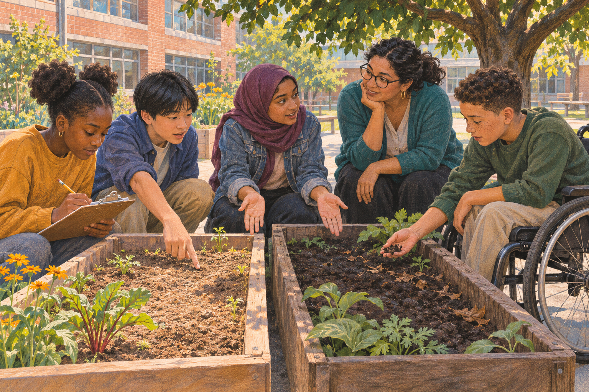
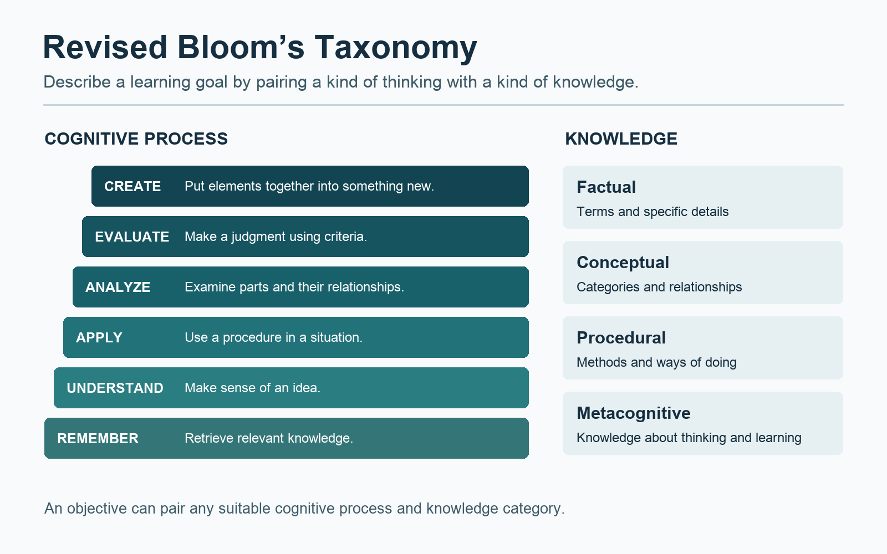

# Chapter 1 — Start with a Learning Goal

Ms. Rivera teaches seventh-grade science. Her students are reading about two explanations for why a school garden bed dries faster than another. When she asks which explanation the class’s observations support, several students pick one and quote a sentence from the reading. Their answers leave her with a question. Can the students explain how an observation supports their choice?

A colleague suggests **shared annotation**, an approach in which students attach comments to specific passages and respond to one another. Ms. Rivera could try it on paper or in a digital space if her school provides a suitable tool. Before she chooses an approach, she needs to know what those comments would help students learn and what they would tell her about their thinking.

You’ll follow this fictional lesson through the book. In this chapter, you’ll define a learning challenge, write a goal, and decide what would count as evidence. You’ll use those decisions in Chapter 2 to compare ways to teach the lesson and test a tool before choosing it.

*Ms. Rivera’s students collect observations in the school garden. Illustration of the fictional case.*

### Garden Evidence Card

The class checked the beds at the same times on two days. These are the observations they recorded.

| Observation | Sunny bed | Shaded bed |
|---|---|---|
| 1 · Day 1 at 10 a.m. | Surface soil damp | Surface soil damp |
| 2 · Day 1 at 2 p.m. | Surface soil dry to the touch | Surface soil still damp |
| 3 · Day 2 at 10 a.m. | Surface soil damp | Surface soil damp |
| 4 · Day 2 at 2 p.m. | Surface soil dry to the touch | Surface soil still damp |

**Explanation A · Faster evaporation.** More sunlight may have warmed the soil and increased water loss from the sunny bed. **Explanation B · Less water at the start.** The sunny bed may have held less moisture even though both surfaces felt damp in the morning. The log gives students a pattern to explain. It leaves the amount of starting soil moisture and the soil temperature unknown. As you follow the case, ask which details were observed and which are proposed explanations.

## Learning Outcomes

By the end of this chapter, you can:

1. Explain a learning challenge using information about the learners and their setting.
2. Write an observable learning goal and connect it to an applicable curriculum standard where relevant.
3. Judge whether a learning activity and its proposed evidence match the thinking required by the goal.

## Learners and the Learning Challenge

### Learners and Context

**Learner context** includes what learners already know and can do, along with the conditions in which they’ll do the work. In Ms. Rivera’s class, students have practiced citing passages in discussion. They’re now learning to connect observations to explanations. The class has one period for the task, and students can use school devices in class. Those details help her decide where to start and what she can reasonably ask students to do.

Start with information that could change a decision. A short sample of learner work can help you identify what students already do independently and where they need support. A quick conversation with learners might reveal that they understand a task when they discuss it with a partner but struggle to express the same reasoning in writing. If you’re designing for a group you haven’t taught, record what you know, what you’re assuming, and what you could ask or check before teaching.

### A Challenge Worth Addressing

A **learning challenge** is a specific difficulty or opportunity for growth that instruction can address. Ms. Rivera considers two descriptions of the challenge: “Students need a way to share annotations” and “Students can cite a relevant detail and need practice explaining how it supports an explanation.” The second gives her something to teach. It also gives her a way to compare possible activities, including partner discussion, individual written reasoning, and shared annotation.

Keep the challenge small enough to address in the time you have. “Improve scientific reasoning” could guide a unit. For one lesson, Ms. Rivera can focus on connecting one observation to one explanation. To check her interpretation before teaching, she could ask a few students to explain aloud why they chose a detail. Their reasoning might confirm the challenge or suggest that she should clarify the question first.

**Clarify the learning challenge.** A colleague says, “They need a more engaging way to read.” What would you ask before choosing a tool?

*Sample reasoning.* I’d ask what students do now and where their work suggests a difficulty. In this case, students can quote a relevant detail. I’d ask them to explain the link aloud or in a short response. If they can explain it when prompted, I might revise the directions before changing the activity. If they struggle to explain it across response formats, I’d model the reasoning and give them a chance to practice it.

## Learning Goals and Standards

### Observable Learning Goals

A **learning goal** states what learners should know or be able to do. An observable goal names something learners can say, make, or do that lets you examine their understanding. Begin with the thinking you want them to do. Add the conditions or **criteria**, the features you’ll look for in successful work, that matter for this lesson.

For one lesson, you may also hear this kind of goal called a **learning objective**. To write one, start with three questions:

1. **What will learners do?** Name the performance you want, such as explaining a connection.
2. **What will they work with?** Include any materials or conditions that matter, such as two explanations and the class’s observations.
3. **What would a successful response include?** Decide what you’ll look for, such as a relevant observation and reasoning that connects it to the explanation. You can put these criteria alongside the objective.

Ms. Rivera’s first draft is “Students will understand how observations support explanations.” She asks herself what students could do to show that understanding and revises it: “Given two explanations and the class’s garden observations, students will explain how one observation supports one of the explanations.” A written or spoken response could make that thinking available to her. Both formats can be judged by the same criteria.

### Standards and the Thinking They Require

#### From a Standard to a Lesson Goal

A **curriculum standard** states a learning expectation for a subject, grade band, or program. When a standard applies, identify the part your lesson addresses and use its wording to check your goal. If a standard expects learners to construct and support explanations across a unit, one lesson might focus on explaining the link between an observation and a claim. Make that scope clear when you record the connection. In a workshop or another setting without a formal curriculum standard, use the relevant program expectation or performance need to guide the goal.

Ms. Rivera uses [Practice 7 of the Next Generation Science Standards, Engaging in Argument from Evidence](https://www.nextgenscience.org/sites/default/files/Appendix%20F%20%20Science%20and%20Engineering%20Practices%20in%20the%20NGSS%20-%20FINAL%20060513.pdf) as a starting point. In grades 6–8, the practice asks students to use evidence and reasoning to support or challenge explanations. For this lesson, she chooses one part of that practice: explaining how a single observation supports a claim. Comparing the strength of several pieces of evidence could come later. When you consult a standard, name the part you can teach and gather evidence for in the time you have.

#### Bloom’s Taxonomy and Task Demands

The revised **Bloom’s Taxonomy** gives teachers a vocabulary for describing what learners are thinking about and what they do with that knowledge. The **knowledge dimension** includes facts, concepts, procedures, and knowledge of how you think and learn. The **cognitive process dimension** describes what learners do with that knowledge, such as recalling it or judging how well it fits a new situation. [Krathwohl’s overview of the revised taxonomy](https://ocw.metu.edu.tr/pluginfile.php/9009/mod_resource/content/1/s15430421tip4104_2.pdf) explains how the two dimensions work together (Krathwohl, 2002).

*Figure 1.1. Revised Bloom’s Taxonomy combines two dimensions. The cognitive processes are remember, understand, apply, analyze, evaluate, and create. The knowledge categories are factual, conceptual, procedural, and metacognitive. An objective can pair any suitable process and knowledge category. Original illustration based on Krathwohl (2002).*

| Kind of thinking | Example from the garden lesson |
|---|---|
| **Remember** · Retrieve knowledge. | Recall the meaning of *evaporation*. |
| **Understand** · Make sense of an idea. | Explain in your own words how evaporation can dry wet soil. |
| **Apply** · Use a procedure in a situation. | Use the class’s soil-moisture measurement procedure on another garden bed. |
| **Analyze** · Examine parts and how they relate. | Sort observations by which explanation each could support, then describe the links. |
| **Evaluate** · Make a judgment using criteria. | Use relevance and consistency to judge whether the observations favor one explanation. Explain what remains uncertain. |
| **Create** · Put ideas or elements together into a new whole. | Design a follow-up investigation that could help distinguish the two explanations. |

Read the whole task and picture what a learner would produce. The verb *explain* can ask for a remembered definition or for reasoning about unfamiliar evidence, depending on the rest of the prompt. Ms. Rivera wants learners to connect an observation to a claim. Recalling what evaporation means may help them do that. Her activity also needs to give them practice making the connection itself.

**Compare two learning goals.** Which goal fits Ms. Rivera’s challenge, “Identify a relevant observation” or “Explain how an observation supports an explanation”? What might she do with the other goal?

*Sample reasoning.* I’d choose the second goal because it calls for the link missing from the students’ earlier work. Identifying an observation is a useful step on the way. If a learner chooses an irrelevant detail, Ms. Rivera can help them narrow the evidence before asking for the connection.

## Alignment of Goals, Activities, and Evidence

### The Learning Activity

**Alignment** is the fit among the learning goal, what learners do to develop that learning, and what their work reveals about it. Start with the goal. Then ask whether the activity gives learners a chance to practice the thinking it calls for. Finally, decide what you’ll examine to judge how their thinking is developing.

Ms. Rivera considers asking students to highlight a passage and submit it. Highlighting can help students locate a relevant detail. To give them practice with the connection, she could model an explanation, then ask partners to select an observation and take turns explaining why it supports a claim. A listener can respond with a question such as “How does that observation help you choose?” She could facilitate this on paper or ask learners to attach a comment to an excerpt in a shared space. Both versions can support the same goal if learners have time and a way to make their reasoning explicit.

### Evidence of Learning

#### What Learners Say, Make, or Do

**Evidence of learning** is learner work or performance you can interpret in relation to a goal. Ms. Rivera asks each learner to choose one explanation and complete a brief response: “One observation that supports this explanation is ___. It supports the explanation because ___.” She checks whether the observation is relevant and whether the reasoning connects it to the chosen explanation. An oral response can supply the same evidence if she uses those criteria consistently.

#### What Task Completion Reveals

A submitted highlight tells Ms. Rivera that a learner marked a passage. A comment count tells her how often a learner posted. She can use either record to investigate participation. To learn whether a student can reason from an observation, she needs to examine what the student says about it. For instance, “The sunnier bed dried faster, which supports the explanation that it lost more water through evaporation” gives her a connection to examine. A response that says “The sunnier bed dried faster, so I picked that one” gives her a starting point for feedback. She can ask the learner how sunlight relates to the proposed explanation.

**Choose evidence that matches the goal.** Ms. Rivera can collect three comments from each learner or one response explaining how an observation supports a claim. Which would you choose for this goal, and what might you still learn from the other record?

*Sample reasoning.* I’d collect the explanation and apply the two criteria. The comments might show where learners participated or which part of the text prompted questions. I’d read their content before drawing conclusions about reasoning.

#### A Completed Lesson Sketch

Ms. Rivera puts the decisions together on one page. The challenge tells her what needs attention. The objective names what students will do. The activity gives them practice, and the evidence gives her a basis for judging what they can do on their own.

| Design decision | Ms. Rivera’s first sketch |
|---|---|
| **Learners and challenge** | Seventh-grade students can point to a relevant detail in discussion. Some need practice explaining how it supports a claim. I’ll check that interpretation by asking students to explain a choice before the lesson. |
| **Objective and standards connection** | Given two explanations and the garden evidence card, students will explain how one observation supports one explanation. This is one part of the middle-school practice of engaging in argument from evidence. |
| **Activity** | Model the link between a claim and an observation. Ask partners to choose a different observation, take turns explaining its connection to a claim, and ask one clarifying question. |
| **Evidence and criteria** | Ask each student for a short written or spoken explanation. Check for a relevant observation and a reason that connects it to the chosen claim. |
| **Why these fit together** | Students practice the connection with a partner and then make a connection of their own that I can assess. |

**Find the mismatch.** Suppose Ms. Rivera replaces the individual explanation with a poll that asks which bed was dry at 2 p.m. What can she learn from the poll, and what evidence would she still need? Write your answer before checking the sample. Then use the same check on your own sketch.

*Sample reasoning.* The poll tells me which observation students selected. I’d ask them to follow their selection with one sentence about how it supports an explanation. That gives me evidence of the reasoning in the objective.

## Apply It to Your Design

Create a one-page sketch for a lesson you could teach, prototype, or discuss with a colleague. Carry it into Chapter 2.

1. **Learners and challenge.** Describe the learners and setting. Identify a specific challenge and the information that supports your interpretation. Mark one assumption you should check.
2. **Goal and standard.** Write one observable learning goal. Name the applicable standard or expectation where relevant and explain the connection in a sentence.
3. **Activity and evidence.** Describe what learners will do to practice. Name one piece of evidence you’ll examine and specify what in that evidence would demonstrate the goal. Explain in one sentence why the activity and evidence match the thinking the goal calls for.

Read the goal, activity, and evidence together. A colleague should be able to explain how the activity gives learners practice and how the evidence captures the same thinking.

### Dig Deeper

Justify one consequential choice in your sketch using evidence about your learners or relevant scholarship. Explain how that evidence supports the choice, where it leaves uncertainty, and what new information might lead you to revise it.

## Key Takeaways

- A bounded learning challenge gives you a basis for comparing approaches.
- An observable goal identifies the thinking or performance learners will demonstrate.
- The activity and evidence should both match the goal. Bring that alignment into your technology decision.

## References and Optional Reading

Krathwohl, D. R. (2002). A revision of Bloom’s taxonomy: An overview. *Theory Into Practice, 41*(4), 212–218. <https://doi.org/10.1207/s15430421tip4104_2>

NGSS Lead States. (2013). *Appendix F: Science and engineering practices in the Next Generation Science Standards*. <https://www.nextgenscience.org/sites/default/files/Appendix%20F%20%20Science%20and%20Engineering%20Practices%20in%20the%20NGSS%20-%20FINAL%20060513.pdf>

For a deeper comparison of learning goals, read Krathwohl’s overview of the revised taxonomy. Use its discussion of knowledge and cognitive processes to compare two tasks that cover the same topic but ask learners to think in different ways.
