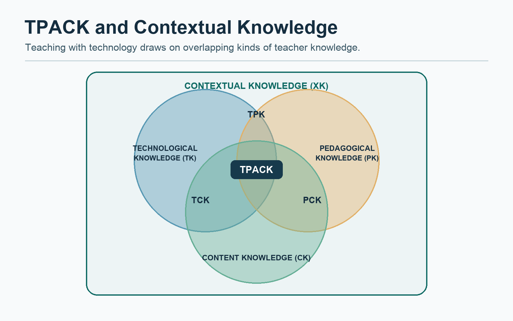
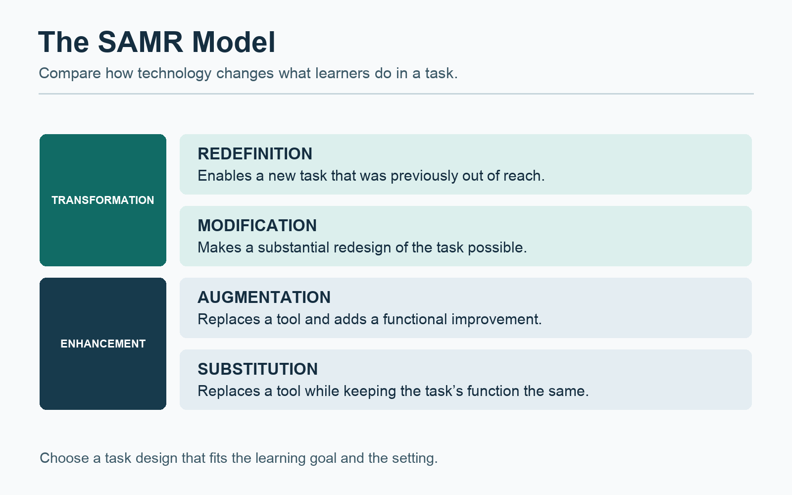

# Chapter 2 — Choose Technology with Purpose

Ms. Rivera has a goal for her seventh-grade science lesson. Given two explanations and the class’s garden observations, students will explain how one observation supports one explanation. Partners could mark evidence on paper, write a question, and exchange their work. In a shared digital text, they could also keep a question beside the observation it refers to so other pairs can read it and use it in a later lesson. That possibility matters if Ms. Rivera gives students a reason to return to the questions and checks that they can find them.

In this chapter, you’ll follow Ms. Rivera from a comparison of the two plans to a small tool test. Bring the lesson sketch you made in Chapter 1. Return to the [garden evidence card](01-start-with-a-learning-goal.qmd#garden-evidence-card) when you need the two explanations and the numbered observations. You’ll use your own sketch to decide what a tool would need to make possible for your learners.

*Students try two ways to work with the same garden evidence. Illustration of the fictional case.*

## Learning Outcomes

By the end of this chapter, you can:

1. Explain how knowledge of content, pedagogy, technology, and context informs a technology choice for a learning goal.
2. Compare what learners do in two versions of a task and explain how the change serves the goal.
3. Justify a provisional technology decision using a representative test and a comparison with a plausible alternative.

## TPACK and Technology Fit

### Foundations of TPACK

**Technological Pedagogical Content Knowledge (TPACK)** is a framework for understanding the knowledge teachers bring together when teaching with technology. In their [original paper on the framework](https://journals.sagepub.com/doi/10.1111/j.1467-9620.2006.00684.x), Mishra and Koehler (2006) built on pedagogical content knowledge, the idea that teaching a subject calls for knowing both the subject and how to help learners understand it. Start with the three foundational domains.

| Knowledge domain | What Ms. Rivera needs to know |
|---|---|
| **Content knowledge (CK)** is knowledge of the subject. | She understands evaporation and can explain why an observation may support a claim without settling which explanation is stronger. |
| **Pedagogical knowledge (PK)** is knowledge of teaching and learning. | She knows how to model a response, structure partner discussion, and check each learner’s explanation. |
| **Technological knowledge (TK)** is knowledge of tools and how to use them. | She knows how to attach a comment to a passage, reply to a comment, and find the resulting discussion. |

### Intersections of Teacher Knowledge

#### Pedagogical Content Knowledge

**Pedagogical content knowledge (PCK)** is knowing how to teach particular content. Ms. Rivera anticipates that students may treat a relevant observation as a complete explanation. She models the difference by pairing a quoted observation with a sentence that explains its connection to the claim.

#### Technological Content Knowledge

**Technological content knowledge (TCK)** is knowing how technology can represent or help learners investigate subject matter. Linking an annotation to the exact observation lets readers inspect the relationship between the data and the claim. A comment detached from the observation would make that relationship harder to trace.

#### Technological Pedagogical Knowledge

**Technological pedagogical knowledge (TPK)** is knowing how a tool can shape a teaching approach. A shared thread can support peer feedback if every learner can find a partner’s explanation and reply to it. Ms. Rivera would still need to teach students what a helpful reply does.

#### TPACK in the Annotation Case

Ms. Rivera brings those forms of knowledge together by anchoring each explanation to an observation and asking partners to question the connection before students revise. She can then check whether each revised response contains both a relevant observation and a reason. That coordinated design is how TPACK shows up in the lesson.

### Contextual Knowledge (XK)

**Contextual knowledge (XK)** is what a teacher knows about the settings that shape a decision. [Mishra’s explanation and updated TPACK diagram](https://punyamishra.com/2019/04/17/reimagining-context-in-tpack-new-article/) make this knowledge explicit (Mishra, 2019). Knowing that a school has devices, for example, helps Ms. Rivera plan only if she also knows when students can use them and what those devices can run.

*Figure 2.1. Technological and pedagogical knowledge overlap as TPK. Technological and content knowledge overlap as TCK. Pedagogical and content knowledge overlap as PCK. TPACK is the overlap of all three. Contextual knowledge (XK) surrounds the domains and informs their use. Original illustration based on Mishra and Koehler (2006) and Mishra (2019).*

#### Immediate, Proximal, and Distal Contexts

Brianza et al. (2022) describe three levels. In the **immediate context**, Ms. Rivera considers learners’ experience with commenting and the devices and supports available in class. In the **proximal context**, she checks school approval, student account permissions, and whom she can ask for help. In the **distal context**, she considers how broader differences in home connectivity could affect participation if the work continues after school. Together, those details might lead her to plan for all replies to happen in class.

**Identify the support students need.** The school supports the tool, but students have had little practice giving feedback on scientific explanations. What would you change first?

*Sample reasoning.* I’d model a reply that asks a partner to connect the observation to the claim, then have pairs practice aloud. School approval addresses one question about context. A model and a practice turn address what students need to do with the tool.

## SAMR and Task Design

### Four Ways Technology Changes a Task

**SAMR** stands for substitution, augmentation, modification, and redefinition. In his [introduction to SAMR](https://www.hippasus.com/rrpweblog/archives/2014/01/15/SAMRABriefContextualizedIntroduction.pdf), Puentedura (2014) uses these categories to describe how adding technology can change a task. To apply the framework, describe what learners do in the version you’re starting with and in the version you’re considering. Here the starting point is a paper excerpt and a brief partner discussion.

*Figure 2.2. Substitution keeps the task’s function the same. Augmentation improves a function within the same basic task. Modification enables substantial redesign. Redefinition makes a new task possible. Use the model to compare what learners do and judge which change fits the goal. Original illustration based on Puentedura (2014).*

#### Substitution and Augmentation

- **Substitution** replaces a tool while keeping the task’s function the same. Students read the excerpt on a school device and carry out the same partner discussion.
- **Augmentation** adds a functional improvement to the same basic task. Partners discuss the same excerpt and use a link to return directly to the passage they marked when they refer to it again.

#### Modification and Redefinition

- **Modification** substantially redesigns the task. Groups attach explanations to different observations. Students compare the reasoning across groups, question a connection, and revise their own explanation using the shared record.
- **Redefinition** makes a task possible that the earlier arrangement could not support. In a longer project, partner classrooms in different locations could annotate a common set of time-stamped garden observations as they are collected, then use the combined record to revise explanations across sites.

### Task Changes and the Learning Goal

Ms. Rivera has one class period and a goal about connecting evidence to a claim. The cross-site project would ask for a different scope of work. For this lesson, a paper exchange can serve a quick partner reply and revision. The shared document becomes more useful if students will compare reasoning across pairs or return to a question later. For example, one partner might reply to an explanation based on Observation 2: “Do we get the same pattern on Day 2?” The pair can use that question to improve its first explanation. When the class prepares a planting recommendation, another pair can find the saved question beside Observation 2, compare it with Observation 4, and decide whether the pattern holds across both days.

**Compare two versions of the task.** One plan digitizes the excerpt. Another asks students to compare two classmates’ explanations and revise their own. Which change might help Ms. Rivera more, and what would you check?

*Sample reasoning.* The comparison and revision could help because students would work directly on explaining the link. I’d check whether they can find two explanations in the time available and whether the prompts direct attention to the reasoning. I’d consider the paper exchange if the digital workflow takes too long.

#### A Rule for Comparing the Garden Beds

One saved reply asks, “Do we get the same pattern on Day 2?” To make that question repeatable, learners can use **computational thinking**. They break the problem into smaller parts, decide which information matters, and express their reasoning as a procedure someone else can follow and test. An **algorithm** is a precise sequence of steps for carrying out a task. You can test one on paper before deciding whether a spreadsheet would help. The [ISTE Computational Thinking Competencies](https://iste.org/standards/computational-thinking-competencies) show how educators use these practices across subjects.

First, make the question precise: *On which days was the sunny bed dry while the shaded bed was still damp at 2 p.m.?* Use the afternoon row for each day. If either reading is missing, record **insufficient evidence**. If both readings are present and the sunny bed is dry and the shaded bed is damp, record **pattern present**. Otherwise record **pattern absent**.

| Day | Sunny bed at 2 p.m. | Shaded bed at 2 p.m. | Rule result |
|---|---|---|---|
| 1 | Dry | Damp | Pattern present |
| 2 | Dry | Damp | Pattern present |
| 3 · practice row | Dry | Missing | Insufficient evidence |
| 4 · practice row | Damp | Damp | Pattern absent |

**Test the rule on a longer log.** Open the fictional [12-day spreadsheet](../resources/garden-observations.xlsx) or [CSV](../resources/garden-observations.csv). The first two days match the garden case. The later days are practice data. With a partner, write the steps in your own words and apply them independently. Compare your answers for a complete day and a day with a blank. If you disagree, revise the instruction that led to different results and test it again.

The rule identifies an observed pattern. Explaining why it occurred takes other evidence. The shared document helps another pair find the question, the observations, and the comparison later. With a longer log, a spreadsheet can help learners filter by time, apply the same rule consistently, and tally days in each category. To use the process in your own setting, start with a different question and a few records, then test your rule on an ordinary case and an exception.

## Tool Testing and Selection

### Selection Criteria and Alternatives

#### Criteria for the Learning Goal and Context

**Selection criteria** are the conditions an option needs to meet for a particular lesson. Ms. Rivera writes three before she tries a tool. Learners need to find the observation and the explanation tied to it, reply to a partner, and revise their own explanation during class. She also checks whether the school has approved the tool and whether student accounts have the right permissions.

A **feature** is something a tool has or does. An **affordance** is an action the tool makes possible for particular learners in a particular setting. A comment feature can let students attach a question to one passage and let another pair retrieve it later. If students can post but can’t find a classmate’s question with their account or device, the feature has limited value for this task.

Test the claim you’re relying on. Suppose a vendor says a tool “supports collaboration.” Ms. Rivera asks a second pair to find a saved question, locate the observation it refers to, and use it in a revision. That test can tell her whether collaboration is workable in her classroom. A claim that the tool improves learning calls for evidence about learning as well. Ask what was measured, who participated, and how closely their task and setting match yours. For a longer adoption, check cost, setup time, support, and whether you can keep or export needed materials if access changes. [Better Edtech Buying](https://cms-live-media.iste.org/Better-Edtech-Buying_-A-Practical-Guide-_Revised-Edition.pdf) offers a guide for weighing evidence and costs at a larger scale.

The [Partnership for 21st Century Learning](https://static.battelleforkids.org/documents/p21/p21_framework_definitionsbfk.pdf) groups four learning and innovation skills as the **4Cs**. Use the ones that matter for your goal. In the garden lesson, **critical thinking** is judging whether an observation supports an explanation. **Communication** is making that connection clear to a partner. **Collaboration** is using a partner’s question to strengthen the explanation. **Creativity** could come into play later when students design a follow-up comparison. Ms. Rivera looks for evidence of the first three in the peer exchange.

Use **Do No Harm** as a check before committing to a tool. Ask who could be excluded, what information learners would have to share, and whether the tool introduces avoidable risks or burdens. Decide which concern you can address and which would lead you to use another approach. For example, if an external tool requires personal accounts without school approval, Ms. Rivera can use an approved shared space or a paper exchange. The [AECT Code of Professional Ethics](https://www.aect.org/get-involved/professional-ethics) offers a starting point for considering access, privacy, and safe participation. Chapters 3 and 4 show how to check those concerns in practice.

#### Technology-Supported and Low-Tech Options

She could use a school-supported shared text, if available, or exchange paper excerpts with space for a response and revision. Imagine a colleague sharing a workflow where students post an explanation, reply, and revise. Ms. Rivera can borrow that sequence and try it in both formats. She records which idea came from the colleague and checks whether it fits her learners and schedule.

### A Test from the Learner’s Position

#### Learner Permissions and Devices

A **representative task** is a small piece of the lesson that captures an important action learners will need to do. To test it, use a school-provided learner preview or approved test account when available, on the kind of device learners will use. Put sample work in the test space. Ask a colleague to post one explanation, then find its source passage, reply, and revise your own response. Run the same sequence with the paper option. If you can only use a teacher view, record which learner actions remain unverified.

#### Test Observations and Open Questions

In this fictional test, Ms. Rivera can open the shared passage on a school device and reply as a learner. She has to reopen the comment pane each time she returns to the text. On paper, the observation and reply stay together, but she has to pass the excerpt back before a partner can revise. The test identifies a workflow difference she can plan for. It leaves open how the students will experience the task. In [Chapter 3’s accessibility checks](03-design-for-access-and-participation.qmd#accessibility-checks-and-supporting-tools), you’ll investigate access in more depth and recheck a choice before use.

### A Provisional Choice

#### The Tool Decision Record

A **tool decision record** captures what you chose, why, and what you’ll check after use. Ms. Rivera plans to try shared annotation for one brief exchange if learners can complete an access check and reach the reply in time. She keeps the paper exchange ready and plans to revisit whether learners could find the reasoning, respond, and revise. Chapter 6 will return to the same criteria after a teaching trial.

Here is the record she could carry into that trial. The test results inform a choice she can revisit. They also tell her where she needs better evidence before the lesson.

| Decision record | Ms. Rivera’s entry |
|---|---|
| **Goal and criteria** | Learners explain how an observation supports a claim. In either version, they need to find the observation and a partner’s explanation, reply, and have time to revise during class. |
| **Options and fit** | On paper, partners exchange the excerpt and write replies beside it. In the shared text, questions stay with their numbered observations, where other pairs can find and use them when the class prepares its recommendation. Both versions support the first goal if I model how to ask about the reasoning. Our students have school devices during class, so I’ll plan the exchange for class time. |
| **What I tried and observed** | I used a school device and a learner view to find the passage, reply, and return to the text. I could complete the sequence, but had to reopen the comment pane. On paper, the reply stayed beside the passage, but I had to pass the excerpt back before revising. |
| **Provisional choice** | Try the shared version for one brief exchange if students can reach the reply easily and find the relevant observation. Keep the paper exchange ready. |
| **What would change my choice** | If learners need repeated help finding the passage or run out of revision time, simplify the layout or switch to paper. Before relying on the shared record for follow-up, check whether a different pair can reopen a question and find its observation. Examine a separate explanation for evidence of each learner’s reasoning. |
| **4Cs and Do No Harm** | Check whether a partner’s question prompts the learner to explain the evidence more clearly. Use school-supported accounts and check who can reach and read the replies. Keep the paper exchange available if access or permissions get in the way. |

**Adapt the record to another setting.** Imagine you’re leading a short workshop where participants compare two sets of instructions for the same workplace task. They need to explain which instructions would help prevent a common error. Which criteria from Ms. Rivera’s record can you reuse? What would you change if participants have shared devices?

*Sample reasoning.* I’d keep the criteria about finding the material, responding to a partner, and having time to revise. I’d test whether each participant has a usable way to contribute. If sharing a device makes that difficult, I’d use printed samples for the exchange and collect each participant’s reasoning separately.

**Decide what to retest.** Your test shows that students can post but have to navigate several steps to find a partner’s comment. What would lead you to keep the digital approach?

*Sample reasoning.* I’d keep it provisionally if I could simplify how students find their assigned comment and verify the revised steps in a learner view. If the steps still cut into time for reasoning and revision, I’d use the paper exchange for this lesson.

## Apply It to Your Design

Add a tool decision record to your lesson sketch.

1. **Fit.** Compare two plausible approaches using TPACK and XK. Explain how the content, teaching approach, and technology fit together in the option you favor. Name one finding about your setting that affects the choice and explain why.
2. **Task design.** Describe what learners do in both versions. Use SAMR to explain what changes when technology is introduced and why the change matters for the goal.
3. **Test and choice.** Write two or three criteria, including a relevant 4C and a Do No Harm check. Try a representative task with the tools and access you can verify, and compare the result with your alternative. Choose an approach provisionally. Record what remains untested and what you’ll look for after use.

### Dig Deeper

Find a colleague’s or educator community’s example of a similar task. Identify one assumption about access, time, or learner experience that may differ from your setting. Explain how you would test that assumption and what result would change your decision.

## Key Takeaways

- TPACK and XK help you explain why an approach fits a goal and setting.
- SAMR helps you describe how the learner’s task changes.
- A small test can inform a provisional choice. Keep the criteria so you can evaluate the choice after use.

## References and Optional Reading

Brianza, E., Schmid, M., Tondeur, J., & Petko, D. (2022). Situating TPACK: A systematic literature review of context as a domain of knowledge. *Contemporary Issues in Technology and Teacher Education, 22*(4), 707–753. <https://citejournal.org/wp-content/uploads/2022/10/v22i4General1.pdf>

Mishra, P. (2019). Considering contextual knowledge: The TPACK diagram gets an upgrade. *Journal of Digital Learning in Teacher Education, 35*(2), 76–78. <https://doi.org/10.1080/21532974.2019.1588611>

Mishra, P., & Koehler, M. J. (2006). Technological pedagogical content knowledge: A framework for teacher knowledge. *Teachers College Record, 108*(6), 1017–1054. <https://doi.org/10.1111/j.1467-9620.2006.00684.x>

Puentedura, R. R. (2014). *SAMR: A contextualized introduction* [Presentation slides]. Hippasus. <https://www.hippasus.com/rrpweblog/archives/2014/01/15/SAMRABriefContextualizedIntroduction.pdf>

For a closer look at XK, read Mishra’s short article. Use it to identify one thing you need to know about your setting that you would miss if you considered the tool and teaching approach alone.
