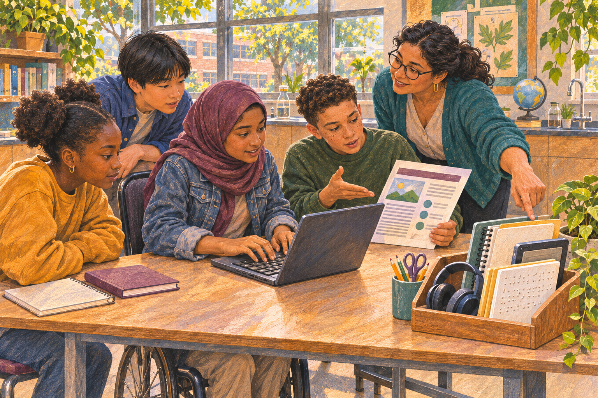

# Chapter 3 — Design for Access and Participation

Ms. Rivera tested threaded comments in Word for the web using her school’s Microsoft 365 environment. Each time she returned to the garden observations in her test, she had to reopen the comment pane. She could complete the task, but wonders how students will manage the passage, a partner’s reasoning, and their own reply. Her draft also identifies the two explanations by color alone. The [Microsoft guide to comments in Word for the web](https://support.microsoft.com/en-au/word/add-or-view-comments-in-a-document) describes the features she’s trying. Your setting may offer a different tool or an accessible text exchange.

If your school uses Google Workspace, you can try the same sequence with [comments and replies in Google Docs](https://support.google.com/docs/answer/65129). Check which tool learners already know, which accounts they can use, and whether they can complete the task with their access supports.

Before teaching, Ms. Rivera revisits the design. She asks where the lesson might create barriers, what options could help students participate, and how she’ll check that those options work. You’ll use the same questions to revise a material or interaction in your lesson.

*Students check how to participate using the digital and printed materials. Illustration of the fictional case.*

## Learning Outcomes

By the end of this chapter, you can:

1. Explain why learner variability is predictable and identify how a lesson feature can create a barrier to participation.
2. Use the three principles of Universal Design for Learning to design options that address a barrier and preserve the learning goal.
3. Investigate an accessibility barrier, revise and recheck a lesson material or interaction, and plan how to learn about remaining barriers after use.

## Learner Variability

### Why Variability Is Predictable

**Learner variability** is the way learners’ strengths, experiences, and support needs differ across people and shift within the same person. Predictable means you can expect variation and plan for it. You’ll learn more about each learner’s needs by asking them and noticing how they approach the work. CAST’s [research overview](https://udlguidelines.cast.org/more/research-evidence/) connects this approach with disability studies, inclusive education, and teaching that builds on learners’ assets.

#### Learner Strengths and Task Demands

A student who helps grow vegetables at home may recognize how shade affects soil. A multilingual student might use ideas from a family conversation to formulate an explanation. A student who uses magnification may have an efficient way to navigate a familiar document and can point out where a new layout breaks that routine. These are resources the class can learn from. Ask what learners already do well and how the task could make room for those strengths.

The same learner’s performance can shift with the subject, the time of day, or the demands of the task. A student who contributes readily to a morning science discussion may want written preparation before an afternoon discussion about an unfamiliar text. A student with a chronic condition may be able to follow a multistep activity one day and need a way to pause and resume on another. Planning options is part of teaching across general and special education settings. Start with choices learners can use as needed and coordinate individualized supports with learners, families, and colleagues as appropriate.

#### Variability the Design Can Anticipate

Ms. Rivera looks at what students must do in order. They need to locate an observation, find a partner’s explanation, and decide what to say in reply. Some will have used threaded comments before. Others may be using that kind of interface for the first time. A short rehearsal with a sample comment could help her learn where students pause. She can also give the two explanations stable written labels so every learner has a way to refer to them.

> **Learner variability is real. Matching instruction to fixed learning styles is a myth.**
>
> **Learner variability.** People differ in what they know, what they bring to a task, and what supports help them participate. The same learner’s needs can change with the task or the day. A student might listen to the garden observations in a quiet room and choose written text when they need to compare exact measurements.
>
> **The learning-styles myth.** Labels such as “visual learner” and “auditory learner” suggest that each person learns best when instruction matches a fixed type. A preference tells you what someone likes or chooses in a given situation. It does not establish what helps them learn more. In an [experiment comparing an audiobook with written text](https://www.kovacs.com/info250readings/Rogowskyetal.pdf), matching the format to adults’ stated preferences did not improve comprehension (Rogowsky et al., 2015).
>
> **What to do in your lesson.** Offer formats that improve access and suit the content. Let learners choose or use the supports they need, then check what their work shows. Ms. Rivera offers readable text and a read-aloud option for the garden observations. In either format, students use the same criteria to explain how an observation supports a claim.

### Barriers in the Learning Environment

A **barrier to participation** is a feature of the task, materials, or setting that makes it harder for someone to take part. Ask what happens when a specific learner tries a specific action. “The student had trouble with the activity” leaves the design question open. “The two explanations are identified by color alone, so a student who can’t distinguish the colors has to guess which explanation the comment refers to” points toward a change you can test.

**Locate the barrier.** A learner can explain a garden observation in conversation but loses their place when moving between the passage and the comment pane. Where would you look first?

*Sample reasoning.* I’d try following the same thread on the learner’s device. I’d check whether the observation number stays available when the comment opens. If the connection gets lost during navigation, I could include the observation number in the reply prompt or try a format that keeps the text and response together.

## Universal Design for Learning

**Universal Design for Learning (UDL)** is a framework for planning options that help learners take part in meaningful, challenging work. CAST organizes the guidelines around three principles. Use them to consider how learners engage with a task, access and make sense of information, and act or express what they know (CAST, 2024). Start with a specific barrier and a clear learning goal. A useful option gives learners a workable path to the thinking the goal calls for.

Use the [numbered CAST UDL Guidelines 3.0 organizer](https://udlguidelines.cast.org/more/downloads/) as a map when a lesson raises a concern. Start with something you want learners to be able to do, such as finding a relevant observation or getting started on a reply. On the [interactive CAST guidelines](https://udlguidelines.cast.org/), choose the principle that fits the concern, then open a numbered consideration for design suggestions. The [CAST research overview](https://udlguidelines.cast.org/more/research-evidence/) explains the evidence behind the guidelines and connects selected considerations with supporting research. Start with one concern and use the resource to plan a change you can try.

### Engagement

**Engagement** concerns how learners connect with the task and sustain their effort. Students who post short replies such as “I agree” might be unsure why the reply matters, what makes a reply useful, or how their partner will respond to a question. The [CAST Engagement guidelines](https://udlguidelines.cast.org/engagement/) give you three places to investigate:

- **Welcoming interests and identities.** Can learners connect the work to an experience, concern, or community they value? Ms. Rivera invites knowledge from gardens, parks, and other outdoor spaces.
- **Sustaining effort and persistence.** Do learners know what a useful reply does, and do they have support when they get stuck? She models a reply that asks how the observation supports the claim and gives pairs a chance to try it.
- **Emotional capacity.** Can learners prepare for an exchange, manage uncertainty, and reflect on how it went? She offers quiet preparation time and asks students to mark a part of their explanation they changed after feedback.

Ms. Rivera anticipates that students might ask, “Why are we doing this?” She opens [Consideration 7.2, Optimize relevance, value, and authenticity](https://udlguidelines.cast.org/engagement/interests-identities/relevance-value-authenticity/). CAST suggests giving learners’ work a meaningful audience. She plans to ask students to recommend a planting location to the school garden team. A partner’s job will be to ask whether the observation supports that recommendation. After the exchange, she’ll check whether replies address the reasoning and ask whether having a recommendation to make changed what students asked their partner.

**Find a reason to engage.** Choose a lesson where learners can complete the task but may struggle to find a reason to do it. Use Consideration 7.2 to identify a change you could try. Write one question you could ask learners and name one thing you could look for in their work to find out whether the change helped.

### Representation

**Representation** concerns how learners access and make sense of information. A learner may be able to read every word of a passage and still have trouble interpreting a measurement or connecting observations made at different times. CAST’s [Representation guidelines](https://udlguidelines.cast.org/representation/) give you three places to look for a change:

- **Perception.** Can learners get to the information in a usable form? Ms. Rivera provides selectable text that can be read aloud and identifies each observation with a written label.
- **Language and symbols.** Can learners interpret the words, numbers, and labels? She explains how the class recorded soil moisture and draws on the words students use for wet and dry soil in their homes and communities.
- **Building knowledge.** Can learners connect the observations to what they already know and notice which relationships matter? She invites students to recall places where soil dries at different rates and gives them a way to compare the two beds.

Ms. Rivera notices that students can read individual entries in the garden log but have to jump across the page to compare the beds at the same time of day. Under **Building Knowledge**, she opens [CAST Consideration 3.2 on highlighting important patterns and relationships](https://udlguidelines.cast.org/representation/building-knowledge/patterns-features/). She uses that idea to organize the observations in a table with one row per observation time and a labeled column for each bed. The written log remains available. The table brings comparable observations together, and students still decide which detail supports their claim and why.

**Choose what to make easier to compare.** Pick two details learners need to connect in a lesson you teach. Sketch a way to place them together, label them consistently, or provide a short explanation of how to read them. Ask a learner to find both details and explain what they can compare. In the garden lesson, Ms. Rivera would listen for whether the learner can locate both observations from the same time and explain what the comparison tells them.

### Action and Expression

**Action and expression** concern how learners interact with the task, communicate what they know, and manage the steps in their work. A learner may be ready to explain a claim but need another way to enter a response or organize a revision. The [CAST Action and Expression guidelines](https://udlguidelines.cast.org/action-expression/) give you three places to look:

- **Interaction.** Can learners navigate the material and respond using an input method that works for them? Ms. Rivera checks whether students can reach the response field and enter a reply using their available tools.
- **Expression and communication.** Can learners communicate the reasoning the goal calls for? Ms. Rivera offers a short written or spoken explanation using routes the class can access.
- **Strategy development.** Can learners plan, monitor, and revise their response? Ms. Rivera gives them a simple sequence to check their work: state the claim, point to an observation, and explain the connection before revising.

Ms. Rivera uses [Consideration 5.1, Use multiple media for communication](https://udlguidelines.cast.org/action-expression/expression-communication/multiple-media/) to decide which response options to offer. Her goal asks for a connection between evidence and a claim. She compares a sample spoken explanation with a sample written explanation and checks whether she can identify that connection in each. Before offering the formats, she checks that students can prepare and submit either one in the time available.

#### Response Options in Digital Storytelling

Suppose the goal is to explain a change in a local habitat using evidence. A learner might make a video with a script or storyboard, record a podcast with interview questions and a transcript, or write a short paper with a labeled diagram. Check whether students already have the tools, time, and production experience their chosen format requires. Offer a manageable path, such as a short written explanation, so every learner can focus on the reasoning. If the objective includes editing a video or conducting an interview, teach and model that skill, provide accessible tools and practice time, and assess it explicitly.

#### Common Criteria Across Response Options

Write the criteria before settling on formats. Share the same rubric with everyone. You can evaluate the scientific explanation by locating its claim, evidence, and reasoning in the submitted work. Ask learners to point you to their evidence, using a page, transcript excerpt, or timestamp as appropriate. You can judge those criteria without knowing how to produce a podcast or edit a video yourself.

| Single-column rubric · Evidence that meets the learning objective |
|---|
| **Claim.** Identifies a specific change in the habitat. |
| **Evidence.** Identifies a relevant observation and gives enough detail for the reader or listener to locate it. |
| **Reasoning.** Explains how the observation supports the claim about the habitat change. |

**Test two ways to show the same learning.** Pick an objective and sketch two possible responses in different formats. Apply the same criterion to both. Then check what each format requires of learners: the tools, production skills, time, and access supports. If one format adds a barrier, decide what support you can provide or what option you can offer. If the format is part of the objective, identify the skill you’ll teach and the evidence you’ll use to assess it.

## Accessibility in Practice

### Why Accessibility Matters

**Accessibility** means people with disabilities can use a material or tool and take part in the activity it supports. A student who can open an excerpt still needs to reach the comment, identify which observation it refers to, and submit a reply. Check the entire path the lesson depends on. Ms. Rivera starts with the path she identified in Chapter 2 and uses sample work in an approved learner view.

Disability can affect mobility, perception, communication, attention, or stamina, and it may be apparent, nonapparent, chronic, or episodic. A learner with arthritis might use keyboard shortcuts or voice input. A learner with migraines might adjust contrast, listen, or return to the task later. Design choices such as descriptive labels, transcripts, and flexible pacing give learners more control over how they participate. Those features can also help someone in a noisy room or with a temporary injury. Building them in early can reduce the need for individual retrofits. Keep providing individual accommodations when learners need them.

Accessibility is also a civil rights obligation in the United States. Title II of the Americans with Disabilities Act covers public schools and other state and local public institutions. Section 504 of the Rehabilitation Act applies to programs receiving federal financial assistance. Use your institution’s procedures to find out what applies to your materials and whom to ask for help. [U.S. Department of Justice guidance on the web and mobile accessibility rule](https://www.ada.gov/resources/2024-03-08-web-rule/). [Federal Section 504 regulations for education programs](https://www.ecfr.gov/current/title-34/subtitle-B/chapter-I/part-104).

### Accessibility Checks and Supporting Tools

#### Keyboard Navigation

Try the actual task using only a keyboard. For a web tool, use Tab or Shift+Tab to move among controls, then use the appropriate key to activate them. Check whether you can tell which control has focus, open the comment, reach the reply field, submit a reply, and return to the passage. Record where you get stuck and which learner action that affects (World Wide Web Consortium, n.d.).

#### Text-to-Speech

**Text-to-speech** reads digital text aloud. Try the school-supported read-aloud feature or another available tool on the excerpt. Listen for whether the written labels and observation numbers make sense in order. If the observations are only available in a photo of a handout, provide them as text. A read-aloud check tells you about how the text is spoken. A screen reader also helps a user navigate interface elements, so test with the relevant access method or ask for support if your lesson depends on it.

#### Accessibility Checkers

An **accessibility checker** flags some issues in a document or page, such as a missing text alternative for an image. Follow up on the report with a manual check. For example, a checker may indicate that an image has a description. Read the description and decide whether it conveys the information students need to make sense of the lesson (World Wide Web Consortium, n.d.).

Use the [WebAIM Contrast Checker](https://webaim.org/resources/contrastchecker/) when you control the colors in a resource. Enter the text and background colors to check their contrast for the text size you’re using. Then check what the colors communicate. Even with sufficient contrast, Ms. Rivera’s explanations still need written labels so students can refer to each one without relying on color.

> **Try a checker on a resource you’ll teach with again.** Open a Word document or PowerPoint deck and run Microsoft’s **Review → Check Accessibility**. Pick one finding, use the guidance to fix it, and run the check again. Confirm the change manually, then save the revised file to your teaching library. If you work in Google Docs or Slides, use Google’s guidance to check a meaningful feature manually, such as heading structure or image descriptions. [Microsoft’s checker rules and fixes](https://support.microsoft.com/en-US/accessibility/office-accessibility/rules-for-the-accessibility-checker). [Google Docs and Slides accessibility guidance](https://support.google.com/docs/answer/6199477?hl=en).

### Revision, Rechecking, and Learner Feedback

#### Rechecks Before Use

Ms. Rivera adds written labels, then uses read-aloud to check that she can identify each explanation. In her first keyboard walkthrough of the Word comment thread, she misses the reply field. She tries a different layout in Word for the web. Each numbered passage has clearly labeled spaces for the explanation, partner reply, and revision in the body of the document. She rechecks the new layout with learner permissions and records whether students can reach and edit each space. If that route still presents a barrier, she’ll use a checked paper or accessible text exchange. These are observations from the fictional classroom setup. Test the workflow on the devices and accounts your learners will use.

#### Learner Feedback After Use

Ms. Rivera plans to ask students after the activity, “Where did you pause or need help finding, reading, or responding to an explanation?” She’ll offer a short written response or a private conversation and compare what students report with her test notes. In [Chapter 6](06-teach-evaluate-and-revise.qmd#questions-for-work-with-the-intended-learners), she’ll rehearse the activity and decide what evidence to gather when she teaches it.

**Record a check and recheck.** Choose one essential action in a lesson material. Test it with a relevant access method, record what happened, change one thing you control, and repeat the check.

*Sample observation record.* In the original excerpt, the two explanations were identified by color. Read-aloud announced the text without identifying which explanation came next. After I added the labels “Explanation A” and “Explanation B,” the labels were announced in order. I’d still ask learners whether they could follow the reference from an explanation to its comment.

## Apply It to Your Design

### A Completed Access Revision Record

| Decision | Ms. Rivera’s record |
|---|---|
| **Barrier and goal** | The reply can be hard to find and match to its observation. Students need to explain a connection between evidence and a claim. |
| **Three UDL questions** | **Engagement:** Do students know why a reply matters? **Representation:** Can they identify the explanation from its label? **Action and expression:** Can they navigate to the reply and enter a response? |
| **First change and why** | Start with access to the reply, guided by [CAST Consideration 4.2 on accessible materials and tools](https://udlguidelines.cast.org/action-expression/interaction/assistive-technologies/). Give the explanations written labels and put reply spaces in the document body so students can reach the place where they’ll respond. |
| **Check and next evidence** | In the threaded version, I missed the reply field in a keyboard walkthrough. In the revised learner preview, I could reach the labeled space and enter a sample reply. The rehearsal will check whether someone else can follow the same route. After use, ask students where they lost their place and what helped them recover. |

For a college discussion or a staff workshop, the same record could follow a learner trying to locate a sample, respond, and return to the original material. Choose the access method and task that matter in that setting.

### Your Access Revision

Revise one material or interaction in your lesson. Add a short record of the revision to your lesson sketch and tool decision record.

1. **Variability and barrier.** Describe who might encounter a barrier, which design feature creates it, and how it affects the learner’s action.
2. **UDL option.** Look at the barrier through engagement, representation, and action and expression. Note one question each principle raises. Use the CAST organizer to choose a consideration to act on first. Explain why it takes priority, what you’ll change, and how the change preserves the thinking in your goal.
3. **Accessibility check and revision.** Test one essential action, record what happened, and revise and recheck the material or interaction. Write one question you can ask learners after use to investigate what the check may have missed.

### Dig Deeper

Ask a colleague to attempt the same action using the revised material. Compare their experience with your notes. Describe what a second check helped you learn and what you still want to ask the people who will use the material.

## Key Takeaways

- Anticipate variability by examining what the task asks learners to do and where the design could create barriers.
- Use engagement, representation, and action and expression to plan options around a common learning goal.
- Check the full path learners need, revise and recheck it, then use learner feedback to investigate barriers after use.

## References and Optional Reading

CAST. (2024). *CAST Universal Design for Learning Guidelines version 3.0*. <https://udlguidelines.cast.org/>

Rogowsky, B. A., Calhoun, B. M., & Tallal, P. (2015). Matching learning style to instructional method: Effects on comprehension. *Journal of Educational Psychology, 107*(1), 64–78. <https://doi.org/10.1037/a0037478>

World Wide Web Consortium. (n.d.). *Easy checks: A first review of web accessibility*. <https://www.w3.org/WAI/test-evaluate/preliminary/>

For your next lesson revision, choose the optional reading that matches the work you’re doing. Use the CAST guidelines to find an option for a barrier you’ve identified. Use the Web Accessibility Initiative checks to plan a first review of an essential action in a web-based activity.

For a closer look at cognitive variability, read Punya Mishra’s [Einstein’s Beams and Feynman’s Colors](https://punyamishra.com/2025/10/19/einsteins-beams-and-feynmans-colors-what-we-lost-when-we-debunked-learning-styles/). It asks what we can learn from differences in how people think after setting aside learning-style matching. In [Beyond Learning Styles II](https://punyamishra.com/2025/11/17/beyond-learning-styles-ii-your-students-minds-work-nothing-like-yours-and-they-dont-know-it-either/), Mishra explores how those differences can go unnoticed. Use either reading to identify one assumption about how learners experience a task and plan how you could check it.
