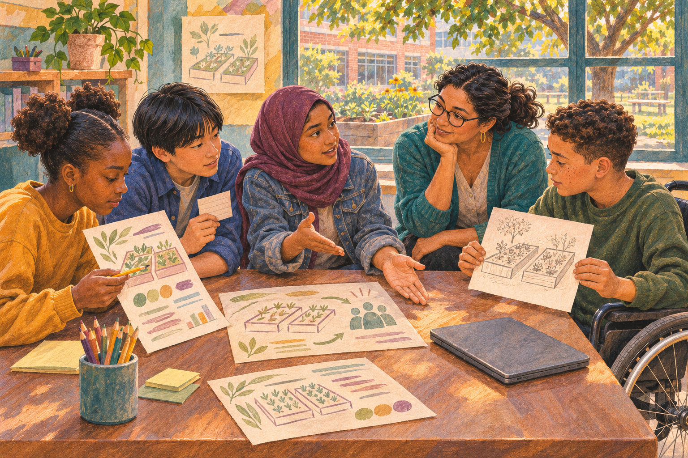

# Chapter 4 — Teach Digital Citizenship and Use Technology Responsibly

Ms. Rivera’s students are preparing a recommendation for the school garden team. One student asks if they can share a screenshot of the class’s comments with the team. Another suggests adding a photo from a gardening website. A colleague offers to generate sample replies with artificial intelligence. Each idea could help the class communicate, and each raises a different question. Whose work would be shared? What can the class reuse? Which thinking should students do themselves?

You’ll work through those decisions before the lesson goes live. Bring the tool decision record and the accessibility revision you made in Chapters 2 and 3. You’ll add safeguards and give learners practice making a responsible choice of their own.

*The class considers what its audience needs and what it can share. Illustration of the fictional case.*

## Learning Outcomes

By the end of this chapter, you can:

1. Plan a way for learners to practice responsible participation during a lesson.
2. Justify a safeguard based on what a tool requires of learners and what the setting permits.
3. Document the basis for reusing a resource and provide attribution where required.
4. Justify whether and how generative AI will be used in planning, teaching, or learner activity.

## Digital Citizenship in Practice

### Modeling Responsible Participation

**Digital citizenship** is how people participate in digital communities and take responsibility for the effects of their actions. In the [ISTE Standards for Students](https://iste.org/standards/students), open Standard 1.2, Digital Citizen, for guidance on online interactions, digital identity, well-being, and privacy (International Society for Technology in Education [ISTE], 2024). Start with a decision learners will actually face. In the garden case, students will respond to classmates and decide how to share their findings with a new audience.

Ms. Rivera models two replies to a sample explanation. “You got that wrong” gives the writer little to work with. “You noticed that the sunnier bed dried first. How does that observation support your explanation?” identifies the idea and gives the writer a specific question to consider. She asks students what they would do if they received each reply. Together they identify a useful norm: name the reasoning you’re responding to, then ask a question the writer can use.

### Practice for Learners

Audience matters, too. A **digital footprint** is the record people leave through online activity. A screenshot of a class discussion can carry names and unfinished comments beyond the people who were expected to read them. Ms. Rivera asks students to rehearse a decision with a fictional example. A teammate wants to forward a thread to someone who couldn’t open the document. What can they share that would serve the purpose and respect the people in the thread?

**Prepare a message for a new audience.** Draft one sentence students could use to share the evidence with the garden team. Identify a detail you would leave in the class workspace and explain your reasoning.

*Sample reasoning.* I’d share the observation and the group’s explanation in a teacher-reviewed summary. Draft comments and names can stay in the class workspace. The garden team needs the evidence behind the recommendation. The class can decide how to acknowledge contributors in line with school expectations.

The same work might become a short item for the school paper, a yearbook caption, or a one-minute Green Day assembly segment. Before adapting it, ask what the new audience needs and what will happen to the message after it’s shared. A yearbook may keep the story for years, and an assembly might be recorded. Check school expectations for sharing student work, names, or images with each audience.

## Privacy, Security, and Healthy Use

### Accounts, Permissions, and Data

**Privacy** concerns what information is collected, who can access it, and how it’s used. **Security** concerns how accounts, files, and systems are protected from unauthorized access or changes. Before asking students to sign in, identify what the tool needs from them. Check who can open the workspace, post, see names, download work, or invite others. An approved account is a starting point. The settings and the particular activity still shape what learners share.

#### External Tools in a K–12 Case

A colleague suggests an external commenting tool. It asks students to create accounts with an email address. Ms. Rivera checks with her school before assigning it. In the United States, the **Family Educational Rights and Privacy Act (FERPA)** protects personally identifiable information in education records, with specified conditions for disclosure. The [U.S. Department of Education’s guidance on using classroom applications](https://studentprivacy.ed.gov/faq/i-want-use-online-tool-or-application-part-my-course-however-i-am-worried-it-violation-ferpa) directs teachers to check approval with their school or district. Ms. Rivera already has a way for students to complete the exchange in the school’s workspace, so she uses that route and checks sharing permissions with a learner account.

#### Institution-Supported Tools in a Higher Education Case

A university instructor wants students to critique one another’s teaching materials. She starts in the institution-supported learning platform. She checks which course members can view the submissions, what students can download, and whether peer access should end after the activity. If students bring a teaching sample from a placement setting, she asks them to use a fictional example or follow the placement’s rules on sharing materials and learner information.

If the critique depends on comments attached to specific passages, the instructor can check whether the institution offers a social annotation tool. [Hypothesis](https://web.hypothes.is/help/creating-hypothesis-enabled-readings-in-an-lms/) and [Perusall](https://support.perusall.com/hc/en-us/articles/360034536353-Overview-of-LMS-integration) have integrations for learning management systems. Ask what your institution supports, whether students face costs or separate account requirements, what information the service receives, and how accessible the reading and reply workflow is. For a short exchange, a supported shared document or a private course discussion with numbered excerpts may meet the same goal.

### Safeguards in Context

Choose a safeguard that fits what could happen. Ms. Rivera limits editing to assigned classmates and checks access before class. To support well-being, she gives students time for the exchange in class and tells them when replies are expected. Students can finish the reasoning on paper if the online workflow creates a barrier. For a starting point, use the [Department of Education’s privacy and education technology resources](https://studentprivacy.ed.gov/privacy-and-education-technology) to prepare questions for whoever approves tools in your setting.

**Choose a safeguard you can verify.** A student with the link can invite people outside the class. How would you protect the draft exchange and verify the change?

*Sample reasoning.* I’d restrict the document to assigned participants, then verify that a learner can reply and an account outside the group can’t open it. I’d share the approved summary separately if the garden team needs a copy.

## Copyright, Attribution, and Reuse

### Permissions, Licenses, and Fair Use

#### Terms for Reuse

A **license** is a set of permissions and conditions from a rights holder. **Attribution** is the credit you give for a work someone else created. When a student finds a photo through a search engine, follow the result to the original page. Look for who made it and what the terms allow. A credit identifies the creator. Permission to copy or adapt comes from the applicable license, direct permission, or another valid basis for reuse. [Creative Commons explains the conditions of its licenses](https://creativecommons.org/cc-licenses/).

In the United States, **fair use** can allow some uses of copyrighted work without permission. The [U.S. Copyright Office’s fair use guide](https://www.copyright.gov/fair-use/more-info.html) explains four factors to consider together: the purpose of the use, the nature of the work, how much and which part you use, and the effect on the work’s potential market. A classroom purpose is one part of that analysis. When you plan to publish material openly or are unsure how the factors apply, use your institution’s guidance or choose a resource with clear reuse terms.

#### A Classroom Reuse Decision

Ms. Rivera considers a photo from a gardening article. The class wants it to illustrate the difference between a sunny and shaded bed. The article has a photographer credit but gives no clear reuse terms. The same idea could be illustrated with a photo the class makes of the garden beds without including students or identifying details. She chooses that option and checks who owns the new photo and what can be shared with the garden team.

### Sources and Credits

Record the creator, title or description, source, license or other basis for reuse, and changes you made. If a license requires attribution, put the credit where readers can find it. Keep the record with the lesson so the next person who adapts it can check the terms.

**Record a reuse decision.** An image page names the photographer and says nothing about reuse. What would you record and what would you do next?

*Sample record.* I’d record the photographer and original page and mark permission as unresolved. I’d look for a clear license on the creator’s site, ask for permission, or choose a suitable resource with terms I can document.

## Responsible Use of Generative AI

### AI in Teacher Planning

**Generative artificial intelligence (AI)** produces material such as text, images, or audio in response to an instruction or question. A **large language model (LLM)** is a type of AI model trained on large collections of data to process and generate language. A chat tool built on an LLM can draft a plausible peer reply. Check the reply against the observations before using it as an example.

Ms. Rivera could give an approved tool a fictional garden example and ask: “Draft three short questions a seventh grader could ask a partner about how an observation supports a claim. Use only the observations provided. Leave the explanation to the student.” She checks each question for clarity and fit. If one asks students to infer rainfall patterns the class never measured, she can remove it or save it as a question for a future investigation. Use fictional or otherwise approved materials when testing AI. Keep identifiable student work and records in the systems and processes your institution authorizes for them.

### AI in Learner Activities

#### The Thinking Learners Need to Do

Before assigning AI, name the thinking learners need to practice and what you’ll use as evidence. Ms. Rivera wants students to explain why an observation supports a claim. She decides students will compose and revise their own explanations. She could still give them a teacher-reviewed AI example to critique as a class. In that activity, students would decide whether the example’s reasoning follows from the supplied evidence.

#### Accuracy, Access, and Privacy

If learners would interact with AI directly, check approval, age and account requirements, access supports, and what the tool receives and retains. Tell learners what use is permitted and what they should verify. Provide an accessible way to practice the target thinking if some learners cannot use the tool. [UNESCO’s guidance](https://www.unesco.org/en/articles/guidance-generative-ai-education-and-research) treats privacy and learner agency as considerations when deciding whether and how to use generative AI.

**Transparency** means making the role of AI understandable. Ms. Rivera labels the example she asks students to critique as AI-generated and explains what she checked. **Disclosure** is a note about how AI contributed to specific work. If class or institutional policy calls for a disclosure, explain when it applies and give learners a model. For example, “I used an AI tool to suggest questions for my partner. I chose and revised one question, then wrote the explanation myself.”

**Check what the AI response adds.** A sample explanation says the sunnier bed dried first because it received less rain. The class recorded sunlight and drying times, but it has no rainfall measurements. How could you use the sample responsibly?

*Sample reasoning.* I’d label it as a sample to critique and ask students to identify the unsupported claim. Then I’d ask what observation they could use instead or what new data they would need. Their responses would give me evidence of their reasoning.

## Apply It to Your Design

### A Completed Responsible-Use Note

| Decision | Ms. Rivera’s note |
|---|---|
| **Participation** | Rehearse a reply that names the observation and asks why it supports the claim. Have students practice on fictional work before responding to a partner. |
| **Safeguard and check** | Limit the working document to assigned classmates. Check that a learner can reply and that an account outside the group can’t open it. Share an approved summary with the garden team. |
| **Reuse and credit** | Use a class-created photo of the garden beds with no students or identifying details in the frame. Record who took it and confirm that it can be shared with the team. If reusing someone else’s image, keep the source and applicable permission with the lesson. |
| **AI use** | Use a fictional example to draft possible discussion questions with a school-approved tool. Check the wording against the goal and evidence. Students write their own explanations. Label any AI example the class critiques and follow local disclosure expectations. |

Use the same record for a university peer critique or a training workshop. Recheck who can see the work if it moves from the original group to a wider audience.

### Your Responsible-Use Note

Add a responsible-use note to your lesson plan and keep it with your tool decision record.

1. **Participation.** Write one learner-facing direction or short rehearsal that helps students practice a responsible choice.
2. **Safeguard.** Name one privacy, security, or well-being concern. Explain what you’ll change and how you’ll check it.
3. **Reuse.** Record the source and reuse terms for one resource and provide any required credit.
4. **AI decision.** State whether and how you’ll use AI in planning or learner activity. Identify what learners will do themselves and how you’ll check any AI-assisted material. If your setting calls for disclosure, draft a sample note learners can use.

### Dig Deeper

**Take the garden story public.** You have the class’s recommendation, a screenshot with student names, a photo credited to someone outside the school, and an AI-drafted headline claiming the team has already chosen a planting location. Choose a format: a school paper item, a yearbook caption, or a 30-second Green Day announcement. Write a version that the class could share after the relevant approvals. Decide what to keep, rewrite, or replace. Then trade with a partner and ask them to flag one detail that needs a permission check or stronger evidence. If disclosure applies under your class policy, write the note that would accompany the piece.

## Key Takeaways

- Teach responsible participation through an action learners can rehearse during the lesson.
- Verify safeguards using the accounts, people, and materials involved in the task.
- Keep reuse decisions and credits with the resource, and preserve the thinking learners need to practice when considering AI.

## References and Optional Reading

Creative Commons. (n.d.). *Sharing openly, sharing globally*. <https://creativecommons.org/cc-licenses/>

International Society for Technology in Education. (2024). *ISTE standards for students*. <https://iste.org/standards/students>

UNESCO. (2023). *Guidance for generative AI in education and research*. <https://www.unesco.org/en/articles/guidance-generative-ai-education-and-research>

U.S. Copyright Office. (2021). *More information on fair use*. <https://www.copyright.gov/fair-use/more-info.html>

U.S. Department of Education. (n.d.). *Privacy and education technology*. <https://studentprivacy.ed.gov/privacy-and-education-technology>

For a deeper review of a tool you’re considering, open the Department of Education’s privacy and education technology page and use its model terms-of-service checklist to identify two questions you would take to your institution’s tool reviewer.
