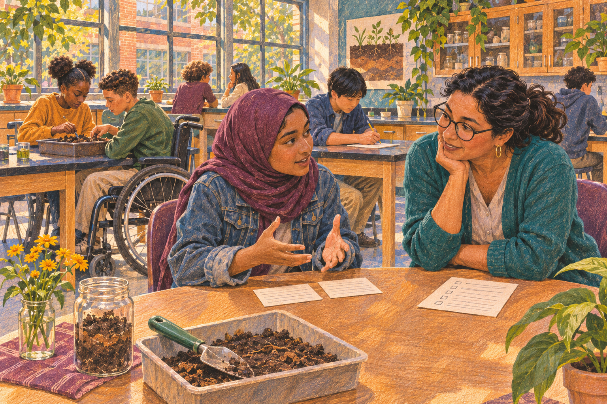
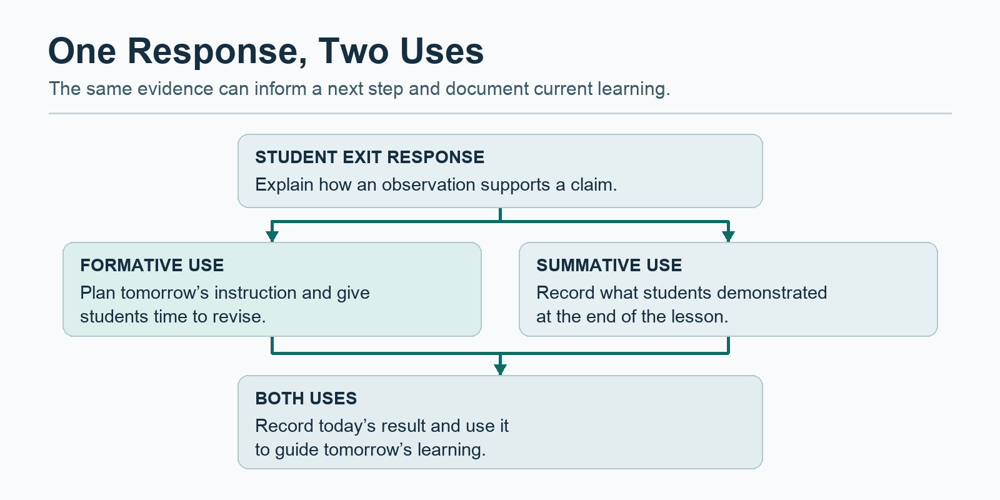

# Chapter 5 — Gather and Interpret Evidence of Learning

Ms. Rivera can count how many students entered a reply in the shared garden document. What she really wants to know is whether each student can explain how an observation supports a claim. A learner may write several replies while still needing help with that connection. Another may offer a strong explanation aloud and leave very little in the shared document.

Before teaching, Ms. Rivera tries out her assessment with a set of fictional responses. She wants to know what the prompt will reveal, how she’ll organize what she collects, and what she’ll do when an answer is incomplete. Bring your Chapter 1 lesson sketch. You’ll build an assessment and decide how you’d act on the evidence it could produce.

*An explanation gives Ms. Rivera evidence she can use to plan feedback. Illustration of the fictional case.*

## Learning Outcomes

By the end of this chapter, you can:

1. Design an assessment task that elicits observable evidence of the intended learning.
2. Organize learner responses so relevant patterns and exceptions are apparent.
3. Justify a feedback or instructional move using evidence from learner responses.

## Assessment Design

### Evidence That Matches the Goal

An **assessment** is a way to gather and interpret evidence about learning. Start by asking what you want to be able to conclude from a learner’s response. Ms. Rivera wants to judge whether a learner can connect an observation to an explanation. A response that identifies the correct garden bed gives her some information. To judge the connection, she needs the learner’s reasoning.

Compare two prompts for the same lesson:

| Prompt | What the response can tell you |
|---|---|
| Which bed dried faster, A or B? | Whether the learner selected the result shown in the observations. |
| Choose an explanation for why one bed dried faster. Cite a relevant observation and explain how it supports your explanation. | Whether the learner can select relevant evidence and explain its connection to the claim. |

Ms. Rivera plans to ask the first question while students work and use the second to gather an individual explanation. She shares two **criteria**, or features she’ll use to judge the response. The observation must be relevant, and the explanation must say how it supports the claim. She can use the criteria for written and spoken responses. In either format, each learner needs a chance to make the connection in their own words.

### Formative and Summative Uses

**Formative assessment** uses evidence to decide how to support learning while there’s still an opportunity to act (Black & Wiliam, 2009). Ms. Rivera reads a draft and notices that a student names the sunnier bed without explaining how sunlight relates to drying. She asks what sunlight could change, then gives the student time to revise. The draft becomes useful because someone can act on what it reveals.

**Summative assessment** uses evidence to judge what learners achieved at a particular point. Ms. Rivera could use a brief individual response at the end of the lesson to record what each learner can explain. A response collected at the end can also inform tomorrow’s teaching. Decide when you need the evidence and what you’ll do with it. That will help you choose what to collect and when to collect it.

#### One Response, Two Uses

*Figure 5.1. One response can serve formative and summative purposes, depending on how the evidence is used.*

The diagram starts with one exit response and branches by how Ms. Rivera uses it. If she uses the response to plan a short lesson and gives students time to revise, that use is formative. If she uses it to record what students demonstrated at the end of the lesson, that use is summative. She can do both with the same response.

| Other source of evidence | Formative use | Summative use |
|---|---|---|
| Short quiz | Use answers to choose what to reteach and give students another chance to try it. | Use the answers to record what students demonstrated at the end of a unit. |
| Lab explanation | Mark where the reasoning needs a clearer link and give students time to revise. | Use shared criteria to judge the final explanation. |

**Choose a prompt for the decision.** You have two minutes before the partner exchange. Would you ask students to choose a relevant observation or write the full explanation?

*Sample reasoning.* I’d ask for the observation if I’m deciding whether pairs are ready to discuss the evidence. If I need to know whether students can explain the connection, I’d collect a brief explanation and save time for a response or revision.

## Evidence Collection and Organization

### Ways to Gather Responses

Choose a way to gather evidence that learners can use and that gives you enough detail for your decision. A short written response works if students can enter it and you can examine it in time. If a learner responds orally, you can mark the same criteria and record a short note about the reasoning. A shared document, a school-supported form, and a paper exit slip can all serve this lesson. Ms. Rivera plans an individual exit slip for the assessment and will use the labeled reply spaces in the shared document to check what students did during the peer exchange. Keeping the purposes clear helps her avoid treating the number of replies as a measure of understanding.

The replies can serve another purpose. Ms. Rivera plans to ask pairs to save one question worth revisiting alongside its observation number. A question such as “Do we get the same pattern on Day 2?” can guide a comparison when the class prepares its recommendation. She’ll use the exit slip to judge what each student can explain and the saved question to plan what the class investigates together next.

Plan how you’ll handle missing work. A blank may mean the learner ran out of time, could not reach the response field, or chose to pass. Record it as **no evidence yet** and follow up. Keep any identifiable records in the setting your institution authorizes for them. If you share an example for discussion, follow the safeguards you developed in Chapter 4.

### Patterns and Exceptions

#### Responses Grouped by Criterion

Start with a small set of responses and read for one criterion at a time. In the examples below, the question is whether the evidence supports the claim that the sunnier bed dried faster because of greater evaporation. The short notes preserve what each response actually gives Ms. Rivera to work with.

| Fictional response | Relevant observation | Connection to the claim |
|---|---|---|
| A. “The sunnier bed dried first. Warm soil can lose water faster, so this fits the evaporation explanation.” | Present | Present |
| B. “The sunnier bed dried first. That is why I chose evaporation.” | Present | Needs a link between sun exposure and water loss |
| C. “Water can evaporate faster in warmer conditions.” | Needs an observation from the garden | Explains a general idea, with no link to a specific observation |
| D. No response submitted. | No evidence yet | No evidence yet |

#### Tables and Charts for Learner Evidence

For a larger group, a paper tally or spreadsheet can help you count which criteria need attention. Give each learner response one row and use one column per criterion. Add a short note for an exception worth following up on. With this set, two of the three submitted responses use a relevant observation, and one connects an observation to the claim. One response is missing. A simple bar chart could compare how many submitted responses met each criterion. Label the counts and report missing responses separately. Return to the original responses when you decide what to teach next. A count tells you where to look, and the learner’s words help you decide what to do.

**Keep the exception visible.** A colleague records B, C, and D together as “needs more work.” What would you record so you could make a better instructional decision?

*Sample record.* B has relevant evidence and needs help explaining the link. C has a scientific idea and needs help choosing an observation that fits it. For D, I’d record that evidence is missing and find out what support would make a response possible.

## Interpretation and Feedback

### Responses in Relation to Criteria

To **interpret** a response is to explain what it suggests about the learning goal and what remains uncertain. Start with the evidence in front of you. In response B, the learner points to a relevant observation and makes a choice. The link is missing from the response. Ms. Rivera can ask for that link before deciding whether the learner understands it or needs additional teaching. She can also check her own instructions if several students read the prompt as a request to choose a claim and cite a detail.

For response C, she would take a different next step. The learner explains a relevant scientific idea. She can ask which garden observation would help them apply that idea. If more evidence would help, she might offer a brief follow-up conversation or invite the learner to annotate an observation and explain the connection.

### Feedback and Instructional Adjustments

**Feedback** is information learners can use to understand how their work relates to a goal and what to do next. Useful feedback clarifies the goal, names something about the current work, and gives the learner a way forward ([Hattie & Timperley, 2007](https://assess.ucr.edu/sites/default/files/2019-02/hattietimperley_2007.pdf)). For response B, Ms. Rivera might write: “You chose a relevant observation. Add a sentence explaining how the sunnier conditions could affect water loss.” She sets aside time to add the sentence and asks the learner to check it against the two criteria. She can then read the revision to see whether the feedback helped the learner make the link.

Decide whether to respond to an individual, a group, or the whole class. If several learners cite observations without linking them to a claim, Ms. Rivera could model that link with a parallel example and have students revise. Learners who already explain the link could consider whether a second observation would strengthen it. She plans a quick recheck for both groups. In Chapter 6, you’ll use this same reasoning to distinguish what a teaching trial reveals about the lesson from what it reveals about learning.

**Choose a next move.** Several learners write responses like B. One writes a response like C. What would you do next, and what would you ask learners to produce so you can tell whether it helped?

*Sample reasoning.* I’d model how to add a reasoning sentence for the learners who already chose relevant evidence. I’d ask the learner with the general idea to select an observation and explain why it fits. I’d check the revised responses for the same two criteria.

#### AI as a Feedback Rehearsal

In Chapter 4, Ms. Rivera checked an AI-generated explanation against the class observations. Here she can use the same habit to rehearse giving feedback. **Interpret the response yourself first.** If you use AI to try out different wording, check that the feedback reflects the learner’s actual work and gives them a next step they can take.

Ms. Rivera has already read fictional response B and identified the missing link. She asks an approved AI tool: “Suggest two short feedback messages for this fictional response. Use these criteria: a relevant observation and an explanation of how it supports the claim. Give the learner a next step that leaves the reasoning to them.”

Suppose one draft says, “Explain that sunlight warmed the soil and made it lose water faster.” Another says, “You chose a relevant observation. Add a sentence explaining how the sunnier conditions could affect water loss.” Both address the missing link. The second gives the learner a direction and leaves them to work out the connection. Before using a suggestion, read it alongside the response and criteria. Check what it assumes, whether the next step is doable, and how you’ll use the revision to decide what to do next. Keep identifiable learner work in the systems and processes your institution authorizes for it.

## Apply It to Your Design

### A Completed Assessment and Evidence Plan

| Decision | Ms. Rivera’s plan |
|---|---|
| **Prompt and criteria** | Ask each learner to choose an explanation, cite one numbered observation, and explain the connection. Check for a relevant observation and a reason that links it to the explanation. |
| **Collection and record** | Collect a short written or spoken response. Use one row per learner and one column per criterion, with a note for missing evidence. Keep the records in an approved space. |
| **Interpretation** | In response B, the observation is relevant and the reasoning is missing from the response. Ask for the link before drawing a conclusion about what the learner understands. |
| **Feedback and recheck** | Ask the learner to add a sentence connecting sunnier conditions to water loss. Give time to revise and check the revised sentence against the same criterion. |

In workplace training, you might ask participants to recommend one of two procedures and explain how it would prevent an error. The same plan tells you what to collect, what to look for, and what participants can revise after feedback.

### Your Assessment and Evidence Plan

Create a short assessment and evidence plan for your lesson.

1. **Design the assessment.** Write a prompt that asks learners to demonstrate your goal. Define two or three criteria. Explain when you’ll gather the response and what decision it will inform.
2. **Organize the evidence.** Choose how learners can respond. Sketch a recording table and enter two fictional responses. Show how you’ll record missing evidence separately.
3. **Plan a next move.** Interpret one of your sample responses in relation to the criteria. Write a feedback message or instructional adjustment and explain how you’ll check whether it helped.

### Dig Deeper

Trade assessment plans with a colleague. Each of you writes a fictional response that could be read in two ways. Compare how you interpreted the two responses and revise a criterion or a prompt so it gives you clearer evidence. Keep a note of what ambiguity remains and how you would follow it up with a learner.

**Transfer the comparison rule.** In [Chapter 2](02-choose-technology-with-purpose.qmd#a-rule-for-comparing-the-garden-beds), you tested a procedure for handling incomplete garden observations. Try the same process with the fictional responses A–D. Agree on when to mark evidence present, when to note that a submitted response needs a follow-up, and when to record no response yet. Apply your rule independently to B and D, then compare your notes. Add a step to flag an ambiguous case for review. Use the rule to organize the evidence, then read the response to decide what feedback would help.

## Key Takeaways

- Write the prompt and criteria around the thinking learners need to demonstrate.
- Organize responses so you can identify patterns, exceptions, and missing evidence.
- Choose a next move that follows from the work, and give learners a chance to act on it.

## References and Optional Reading

Black, P., & Wiliam, D. (2009). Developing the theory of formative assessment. *Educational Assessment, Evaluation and Accountability, 21*(1), 5–31. <https://doi.org/10.1007/s11092-008-9068-5>

Hattie, J., & Timperley, H. (2007). The power of feedback. *Review of Educational Research, 77*(1), 81–112. <https://doi.org/10.3102/003465430298487>

Use [Black and Wiliam’s discussion of formative assessment](https://www.bates.edu/research/files/2018/07/Black-Wiliam2009_Article_DevelopingTheTheoryOfFormative.pdf) to identify who can act on evidence in one lesson. Think of a decision the teacher can make, one a peer can help with, and one a learner can make independently.
