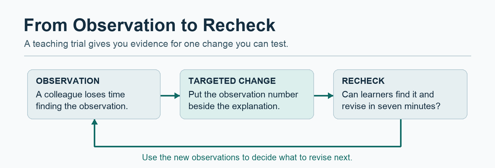

# Chapter 6 — Teach, Evaluate, and Revise

Ms. Rivera has seven minutes set aside for students to read a partner’s garden explanation, ask about the evidence, and revise their own response. She has already tried reaching the reply field from a learner’s account and prepared a different layout. During a rehearsal with two colleagues, both reach the response space. One still stops to ask, “Which observation goes with this explanation?” The moment matters. Every minute spent finding the right passage takes time from discussing what the evidence supports.

A small trial gives you a chance to investigate a question like this while you can still change the lesson. Bring your tool decision record and assessment plan. You’ll decide what to observe, what the observations can tell you, and which revision to try next.

*Ms. Rivera observes a peer rehearsal before trying the activity with students. Illustration of the fictional case.*

## Learning Outcomes

By the end of this chapter, you can:

1. Plan a small teaching trial with a focused question and a way to gather relevant observations.
2. Distinguish what a trial shows about how the lesson and tool function from what it can establish about learning in the intended setting.
3. Revise a consequential part of the lesson and explain how the evidence informed the change.

## The Teaching Trial

### A Focused Trial Question

A **teaching trial** is a small enactment of part of a lesson to gather evidence about a design question. Choose a segment where the answer could change what you teach, how learners participate, or how you gather evidence. Keep the trial long enough for someone to complete the important action. A colleague can help you rehearse instructions or try a workflow. With the appropriate permissions, a trial with intended learners can also give you direct information about how they experience the task and what their work shows.

Ms. Rivera starts with a question: “Can a pair find the observation behind a partner’s explanation, use it in a reply, and leave enough time to revise?” She selects one passage and two fictional explanations. Her colleagues try the exchange with the instructions and materials she intends to use. She asks one of them to follow the instructions as written, including where to find the partner’s response. She wants to find places where she would otherwise fill in missing directions aloud.

### Observation and Evidence

Tell your observer what to record before you begin. Ask for observable events or words. “The participant opened the reply area, returned to the passage list, then asked for the observation number” gives you a place to investigate. You can ask the participant afterward what they were looking for. A short record with the step, what happened, and one follow-up question may be enough.

Ms. Rivera asks the observer to note where a participant requests help, whether each reply points to the right observation, and whether there’s time to revise. She also keeps one fictional revised response so she can check whether her collection method captures the work she needs. She uses sample work in the rehearsal and follows the privacy and sharing practices from Chapter 4 if she later gathers actual learner work.

**Pick an observation that could change the design.** A colleague offers to record whether the activity “went well.” What would you ask them to note instead?

*Sample observation plan.* Record the first point, if any, where a participant needs help finding the observation, and what they try before asking. Note whether the pair completes a reply and a revision within seven minutes. These details would help me choose where to revise the instructions or layout.

## Evaluation After Use

### Tool Performance Against the Original Criteria

#### The Chapter 2 Tool Decision Record

Reopen the selection criteria from your [Chapter 2 tool decision record](02-choose-technology-with-purpose.qmd#the-tool-decision-record). Ms. Rivera wanted learners to find the observation and its explanation, reply to a partner, and revise within class time. Chapter 3 led her to try labeled reply spaces in the body of a shared Word document. Now she can compare how that revised workflow performed in a short rehearsal and decide what still needs a check. Use the tool decision record to preserve the conditions of the test, including who took part and what devices or permissions they used.

#### Trial Observations and Original Criteria

| Original criterion | What happened in the peer rehearsal | What to check next |
|---|---|---|
| Find the observation and the explanation tied to it. | One colleague asked which observation went with the explanation. The labels were on the passage list, with no number next to the explanation. | Put the number beside the explanation and check whether a participant can find the observation without a reminder. |
| Reply to a partner. | Both colleagues reached the labeled reply spaces and entered a response in the learner view used for the rehearsal. | Check the workflow with the accounts, devices, and access supports students actually use. |
| Revise during the exchange. | One colleague revised within seven minutes. The other was still locating the observation when time was called. | Check whether the new labels leave time for both partners to revise. |

The record helps Ms. Rivera evaluate the tool as it was used for this lesson. She can keep the labeled reply spaces and revise how each passage is referenced. A colleague’s suggestion to switch platforms is worth considering if the navigation problem persists or blocks access in the intended setting.

She also checks whether the shared document will be useful after the first exchange. She asks a colleague who didn’t write the sample reply to reopen the document, find the saved question, and point to the observation it concerns. That checks whether another pair could pick up the question later. If the record is hard to reopen or the link to the observation is unclear, she can collect the questions on paper and post a short, accessible list for the next lesson.

### Evidence of Participation and Learning

#### What the Peer Trial Showed

You can use a peer trial to check whether directions are clear, materials are usable under the trial conditions, and the workflow leaves time for the intended actions. Ms. Rivera’s colleagues know the science and have more practice with shared documents than her students may have. Their revised explanations let her check what her collection method captures. Their reasoning tells her about the adults who produced it. Keep those conditions attached to any conclusion you draw.

#### Questions for Work with the Intended Learners

With students, Ms. Rivera will check two kinds of evidence. To understand participation and tool performance, she’ll record whether students can find the observation and respond, and ask where they needed help. To understand learning, she’ll use [Chapter 5’s criteria](05-gather-and-interpret-evidence-of-learning.qmd#evidence-that-matches-the-goal) to examine individual explanations. A completed reply tells her that a student reached the reply stage. The reply or revision may also contain reasoning she can assess. If several students produce strong explanations, she can describe what they demonstrated in this lesson. To tell whether the tool itself helped, she would need evidence that addresses other possible explanations, such as the modeled reply, additional practice, or the revised layout.

**Match the conclusion to the evidence.** Both colleagues submitted a reply. One explained the connection between an observation and the claim. What could you report to another teacher?

*Sample reasoning.* Both colleagues reached the response space in this setup, and one response contained reasoning that the assessment could capture. I’d report those observations and check access and student explanations during the lesson before drawing conclusions about how the activity works with the class.

## Targeted Revision

### What to Retain, Change, or Replace

A **targeted revision** changes a specific part of the design in response to evidence. Start with a barrier or missed opportunity that affects the goal. Ms. Rivera keeps the partner prompt because it directs attention to the reasoning. She adds the observation number next to each explanation and uses the same number in the reply instructions. This change addresses the point where the colleague lost time. She keeps the checked paper or accessible text exchange ready if learners encounter a barrier that the shared document cannot resolve.

If you hear competing suggestions, ask which one responds to the observation and what it would cost learners to try it. A colleague may want to teach a shortcut. Another may suggest putting the information where students need it. Ms. Rivera tries the layout change first because it preserves the exchange and lets students use the same reference whether they read the shared document or use an alternative format.

### Rationale and Next Test

Record the before and after, why you made the change, and what would persuade you to keep it. Keep the record short enough to use again. Ms. Rivera writes, “I added the observation number beside each explanation because a colleague had to stop and ask which passage to use. In the next trial I’ll check whether students can locate the observation without prompting and revise within seven minutes.” She also plans to examine two revised explanations against the criteria so she can check whether the exchange continues to elicit the intended reasoning.

#### From Observation to Recheck

*Figure 6.1. Use an observation from the trial to choose a change, then use the recheck to decide what to revise next.*

The figure follows one change from the rehearsal to the next test. A colleague lost time finding the observation, so Ms. Rivera moved the number beside the explanation. She’ll check whether learners can find it independently and still have time to revise. She’ll use that evidence to decide what to do next.

**Choose one change to try first.** One observer suggests extending the activity. Another suggests moving the observation number closer to the explanation. Which change would you try first and what result would you look for?

*Sample reasoning.* I’d move the number and rerun the exchange because the observer noted a specific navigation problem. If participants find the observation independently and still need more time to reason or revise, I’d reconsider the time allocation.

## Apply It to Your Design

### A Completed Trial and Revision Record

| Decision | Ms. Rivera’s record |
|---|---|
| **Trial question and setup** | During a seven-minute rehearsal with colleagues, can a pair find the observation, reply, and still have time to revise? Ask an observer to note when someone needs help and what they were trying to do. |
| **What happened** | Both reached the reply space. One lost time finding the observation and didn’t revise within seven minutes. The rehearsal revealed a navigation problem under these conditions. |
| **Change and recheck** | Put the observation number beside the explanation. In the next test, record whether learners find the observation independently and still have time to revise. |
| **Evidence of learning** | Examine individual written or spoken explanations using the Chapter 5 criteria. The ability to find and enter a reply gives evidence about participation. The content of the explanation provides evidence about reasoning. |

If you’re developing professional learning, you could rehearse a short demonstration with a colleague and record where the directions or materials need work. Gather evidence from intended participants when you’re ready to judge what they learned.

### Your Trial and Revision Record

Create a one-page trial and revision record for your lesson.

1. **Plan the trial.** Identify a consequential segment, the people and conditions you can use, one focused question, and what you’ll ask an observer to record.
2. **Interpret the evidence.** Run the segment if you can. Record one observation against a criterion from your tool decision record. Explain what it suggests about the lesson or tool and what evidence you’d need to address learning in the intended setting. If you use a fictional observation to rehearse the process, label it as fictional.
3. **Revise and retest.** Change one feature of the lesson in response to the observation. Document the reason and name a result you’ll look for in a recheck.

### Dig Deeper

Ask two observers to describe the same short exchange independently. Compare their notes and identify one difference that would change what you revise. Agree on a clearer observation prompt and explain what it would help you capture next time.

## Key Takeaways

- Plan a small trial around a question that could change a design decision.
- Use the original tool criteria to evaluate performance and gather learner work to investigate learning.
- Document one targeted revision and the evidence you’ll look for in the next test.

## References and Optional Reading

### Kirkpatrick’s Levels and Broader Evaluation in Professional Development

If you’re designing a workshop or professional learning program, use the [Kirkpatrick Model](https://www.kirkpatrickpartners.com/the-kirkpatrick-model/) to choose an evaluation question and decide what evidence could answer it. The examples below are for a workshop on accessible course materials.

| Level | Evaluation question | Example evidence and timing |
|---|---|---|
| **1. Reaction** | How relevant and useful did participants find the workshop? | An exit response asks participants which accessibility check they expect to use and why. |
| **2. Learning** | What can participants now do? | At the end of the workshop, ask participants to revise a sample document and explain one fix. Review the revision against shared criteria. |
| **3. Behavior** | Are participants applying what they learned in their work? | A few weeks later, review a new course material they prepared for their own students. |
| **4. Results** | What changed for learners or the program? | Over a term, track whether students report fewer barriers in course materials. Consider other changes that could have affected the result. |

Kirkpatrick Partners. (n.d.). *The Kirkpatrick Model*. <https://www.kirkpatrickpartners.com/the-kirkpatrick-model/>
