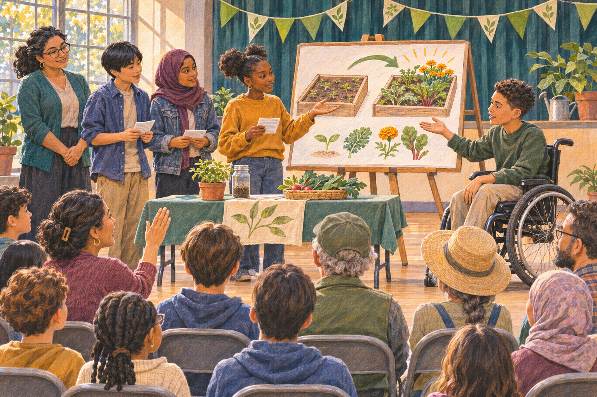

# Chapter 7 — Lead and Learn with Colleagues

“If the sunny bed dries first, where should we plant?” a student asks as Ms. Rivera collects the class’s explanations. The school garden team is preparing its spring planting plan. It’s a real question the class can help answer.

The lesson began with each student explaining how one observation supported a claim. While preparing the planting recommendation, students reopen the shared document. A pair finds a question that classmates saved beside Observation 2: “Do we get the same pattern on Day 2?” They use the [Chapter 2 comparison rule](02-choose-technology-with-purpose.qmd#a-rule-for-comparing-the-garden-beds) on Observations 2 and 4 from the [garden evidence card](01-start-with-a-learning-goal.qmd#garden-evidence-card). On both days, the sunny bed was dry to the touch by 2 p.m. while the shaded bed was still damp. The pair adds that comparison to the class’s recommendation. Ms. Rivera asks her department colleagues how to share the evidence at Green Day and use an audience question to improve the plan.

*Students present their planting recommendation and take questions at Green Day. Illustration of the fictional case.*

## Learning Outcomes

By the end of this chapter, you can:

1. Evaluate a practice shared by colleagues and justify how you would adapt it for your learners, learning goal, and setting.
2. Prepare two brief accounts of the same lesson: a learner-facing plan for sharing a claim and responding to a school community audience, and a professional share that uses lesson evidence to ask colleagues for feedback.

## Learning from Colleagues

### Practices from Educator Communities

**Professional learning** is the work educators do to develop and improve their practice. It can happen with a mentor, a grade-level team, an online educator group, or colleagues who meet across schools. A **community of practice** forms when people learn together over time about a shared area of work and build practices they can use. Wenger-Trayner and Wenger-Trayner (2015) describe three features: a shared area of interest, relationships that support learning together, and a developing collection of resources and ways of working. A team that regularly brings student explanations to discuss and revises its prompts together can develop all three.

Start with a question from your own work. In Chapter 2, Ms. Rivera borrowed a sequence from a colleague: post an explanation, reply, and revise. Now she asks how to let a wider audience question students’ reasoning while keeping the focus on evidence. A teacher in her department describes a school showcase where visitors submit questions through a form. The teacher reviews them and passes one to each group. Students respond, then revise one part of their explanation. Ms. Rivera asks to examine the question prompt and a sample revision. Those artifacts give her something to adapt and a way to judge how the routine works.

### Fit and Adaptation

#### Learners, Goal, and Setting

A colleague’s account can give you a plausible idea. Before you adopt it, compare who the learners are, what the activity asks them to do, and what the setting provides. The showcase took a full period and had several adult facilitators. Ms. Rivera’s class has a short Green Day assembly slot. The students will speak to other students and visiting families. The garden team is there to decide whether to act on the recommendation. Ms. Rivera moves the revision to the next class and gives the audience a way to ask questions without signing in.

#### Adaptation and Local Testing

To **adapt** a practice is to change it to fit your setting while preserving what makes it useful. Ms. Rivera plans for an adult facilitator to collect spoken, written, or approved digital questions. She rehearses the handoff so learners who aren’t on stage can contribute a response or help revise it afterward. She keeps the public material to what the class can share under the school’s permissions and checks that people can access the evidence in the presentation.

Before relying on the routine, she tries it with one example. The facilitator asks, “Did you measure soil temperature, or are you using sunlight as a clue?” The students have observations about sunlight and drying time. To answer, they need to distinguish what they recorded from what they inferred. Ms. Rivera can use that trial question to check whether the routine invites the thinking she wants.

**Decide what transfers.** A colleague recommends a live digital question board that worked at a showcase. At Green Day, some audience members will have no device. What would you keep, and what would you adapt?

*Sample reasoning.* I’d keep the chance for the audience to ask an evidence question and for students to revise in response. I’d collect questions through a facilitator who can accept them aloud or in writing. If the school offers a digital option, I’d check whether it makes those questions easier to gather and revisit.

## Sharing a Practice

Sharing a lesson with colleagues can be a form of **professional leadership**. You can help a group improve its work by bringing an example others can examine, explaining what you learned, and inviting them to test or improve it. The [ISTE Standards for Educators](https://iste.org/standards/educators) describe learning from others, collaborating, and supporting colleagues as parts of educators’ work with technology (International Society for Technology in Education [ISTE], 2024).

### Students Share with the School Community

#### The Planting Recommendation and Follow-Up

At Green Day, the class shows a labeled table and recommends starting the seedlings that need more consistently moist soil in the bed that stayed damp longer. A family member asks whether both beds got the same amount of water. The students can point to the afternoon observations on both days. Their morning notes describe both surfaces as damp, so the class still needs comparable measurements of how much moisture each bed held at the start.

The class uses a simple process you can repeat with another lesson:

1. **Share the claim and its evidence.** Show the recommendation and the observations that support it.
2. **Save one question that could change the claim.** The facilitator writes the family member’s question next to the observation table in the shared school document. Audience members can ask aloud or hand in a written question.
3. **Revise and plan a follow-up.** Back in class, pairs add a proposed revision beside the same table and question. The class agrees to recommend a small first planting in the bed that stayed damp longer and to treat that choice as provisional. The garden team agrees to use the recommendation for the first planting. On several rain-free days, students plan to give the beds equal amounts of water, measure starting soil moisture at the same depth in both beds, and repeat the measurement at the same times. They’ll note differences in starting moisture and compare days with similar starting readings before deciding whether to follow the same planting plan.

#### What the Shared Document Made Possible

Ms. Rivera returns to her [Chapter 2 tool decision record](02-choose-technology-with-purpose.qmd#the-tool-decision-record). She chose a shared document so pairs could find the same observation, respond to each other, and revise during class. The thread was hard to navigate in her access check, so she tried labeled reply spaces. When a colleague lost time in the [Chapter 6 rehearsal](06-teach-evaluate-and-revise.qmd#trial-observations-and-original-criteria), she put the observation number beside each explanation. In class, pairs could use those numbers to point to the same evidence when they replied.

At Green Day, a printed table would have served the audience. The shared document did its most useful work between meetings. Before the assembly, a saved peer question led students to use evidence from a second day. After the assembly, the facilitator added the family member’s question beside the same evidence so pairs could compare proposed revisions and decide what to measure next. Ms. Rivera can give the garden team an approved copy of the table and follow-up plan while keeping student drafts in the class workspace. Using the [Chapter 2 SAMR lens](02-choose-technology-with-purpose.qmd#samr-and-task-design), she can explain what changed. The audience gave students a reason to defend and revise a recommendation. The shared document made it practical for different pairs to find, use, and add to one record over several sessions.

### Ms. Rivera Learns with Professional Colleagues {#ms-rivera-learns-with-professional-colleagues}

#### What the Lesson Evidence Shows

When Ms. Rivera shares the practice with colleagues, she brings a recreated initial recommendation and its revision. The first recommends one bed because it stayed damp longer. The revision keeps the recommendation provisional and says what the class will measure next. She uses Chapter 5’s criteria to discuss the reasoning and Chapter 6’s trial notes to explain why the labels mattered. The revised recommendation shows how the class qualified a claim. Individual explanations are the evidence she uses to judge what each student can do.

#### Conditions for Use and Questions for Colleagues

A useful share gives colleagues enough context to judge the idea for themselves. Explain the task, what helped it work, and what you would check in a different setting. End with a question that makes it easy for someone to offer advice or evidence. “Any thoughts?” can produce a broad reaction. “How do you give students an equally usable way to take part when audience questions arrive in different formats?” gives colleagues a problem they can help you investigate.

**Prepare a share someone can use.** Read Ms. Rivera’s example. What could you adapt, and what would you ask her before trying it?

*Sample share.* “My seventh graders compared two days of garden observations and recommended a bed for the first planting. A family member asked how much water each bed got, so students made the recommendation provisional and planned a follow-up with the garden team. I can share a recreated version of the table, the question, and the revision. The shared document let pairs work from the same evidence the next day. How would you help every student contribute when only a few can present?”

## Apply It to Your Design

### A Completed Two-Audience Plan

Ms. Rivera adapted a colleague’s showcase routine. She keeps the audience question and revision, uses a facilitator to gather questions during the short assembly, and moves the revision to the next class.

| Audience | Ms. Rivera’s plan |
|---|---|
| **School community** | Students present the recommendation and the two-day pattern at Green Day. A facilitator collects one question that could change the recommendation. Students return to the evidence and use the question to revise the plan. They share the approved summary with the garden team. |
| **Professional colleagues** | Bring a recreated before-and-after recommendation and the conditions that shaped it. Explain what the shared record let pairs do and what the evidence shows about this lesson. Ask colleagues how they would help students contribute when only a few can present. |

For a college project or an adult learning program, substitute the group that can use or question the learners’ recommendation. Then identify peers who can help you improve the way you teach the activity.

### Your Two-Audience Plan

Prepare two brief shares based on the lesson you’ve developed throughout the book. One supports learners as they share their work, and the other helps you learn from colleagues.

1. **Learn from an example.** Find a practice someone has shared. Explain how it informed one of your decisions, what fits your learners and setting, and what you would adapt or test locally.
2. **Plan the learner share.** Name a school or learning community audience. Outline how learners will share a claim and its evidence, collect one question, and respond or revise. Identify what they can share and explain what any technology contributes.
3. **Prepare the professional share.** Describe your learning goal, one design decision, and a piece of evidence that informed it. State the conditions colleagues would need to check and ask one question that invites feedback. Identify whether the evidence came from a peer rehearsal or from learners.

### Dig Deeper

Rehearse both shares with a partner. Ask them to pose one question from each audience’s perspective. Decide which question could improve the learners’ work and which could inform your next teaching decision.

In Chapter 1, Ms. Rivera wanted students to explain how one observation supports a claim. By Green Day, the class used a pattern across observations to make a planting recommendation, respond to a challenge, and plan a better comparison. The garden team got a starting plan. The students got another reason to examine their evidence. Ms. Rivera got a practice she can share with colleagues and a follow-up that will tell the class whether to revise the plan again.

## Key Takeaways

- Use a question about your own lesson to guide what you look for in an educator community.
- Compare a shared practice with your learners, goal, and setting before adapting it.
- Give colleagues evidence they can examine, the conditions that shaped it, and a question that invites them to help.

## References and Optional Reading

International Society for Technology in Education. (2024). *ISTE standards for educators*. <https://iste.org/standards/educators>

Wenger-Trayner, E., & Wenger-Trayner, B. (2015). *Communities of practice: A brief introduction*. <https://wenger-trayner.dreamhosters.com/introduction-to-communities-of-practice/>

Use the [introduction to communities of practice](https://wenger-trayner.dreamhosters.com/introduction-to-communities-of-practice/) to examine a group you already learn with. Identify its shared concern, how members learn together, and one practice or resource you could contribute.
