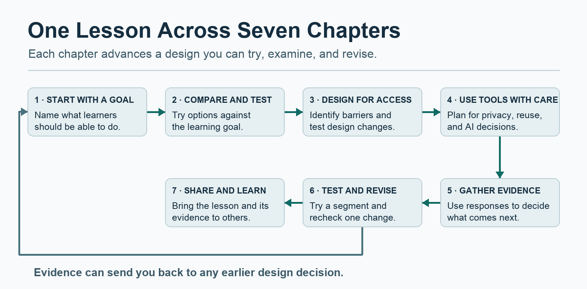

# How to Use This Book

Choose one learning challenge you want to address. It could come from a lesson you already teach, a class you’re preparing to teach, or a setting you can describe with help from a colleague. Keep the challenge small enough to work on in one lesson, workshop, or short sequence. As you read, you’ll develop an instructional design you can explain, try, and revise.

You’ll also follow Ms. Rivera, a fictional seventh-grade science teacher. Her students have garden observations and two plausible explanations for what happened. They need practice explaining how an observation supports a claim. Ms. Rivera tests ways to help them do that, checks how learners can participate, and revises the design based on what she learns. The class eventually brings its recommendation to the school garden team. Your setting and tools may differ. Use the case to recognize the decisions you’ll face in your own work.

## One lesson across seven chapters

*Figure. Each chapter advances one lesson design. Return to an earlier decision when a test, learner response, or colleague’s question gives you a reason to reconsider it.*

| Chapter | Topics | What to carry forward |
|---|---|---|
| [1. Start with a Learning Goal](chapters/01-start-with-a-learning-goal.qmd) | Learner context, learning objectives, Bloom’s Taxonomy, alignment | A description of your learners and challenge, an observable goal, and a first sketch of the activity and evidence. |
| [2. Choose Technology with Purpose](chapters/02-choose-technology-with-purpose.qmd) | TPACK and contextual knowledge (XK), SAMR, affordances, the 4Cs, Do No Harm, computational thinking | A tool decision record with alternatives, test observations, and criteria to revisit. |
| [3. Design for Access and Participation](chapters/03-design-for-access-and-participation.qmd) | Learner variability, Universal Design for Learning, accessibility checks | A revised material or interaction and a record of what you checked. |
| [4. Teach Digital Citizenship and Use Technology Responsibly](chapters/04-teach-digital-citizenship-and-use-technology-responsibly.qmd) | Digital citizenship, privacy, copyright and attribution, generative AI | A responsible-use note covering participation, a safeguard, resource reuse, and an AI decision. |
| [5. Gather and Interpret Evidence of Learning](chapters/05-gather-and-interpret-evidence-of-learning.qmd) | Formative and summative assessment, organizing evidence, feedback | An assessment prompt, criteria, and a plan to respond to learner evidence. |
| [6. Teach, Evaluate, and Revise](chapters/06-teach-evaluate-and-revise.qmd) | Teaching trials, tool evaluation after use, targeted revision | A focused trial question, observations, and a targeted revision to recheck. |
| [7. Lead and Learn with Colleagues](chapters/07-lead-and-learn-with-colleagues.qmd) | Communities of practice, adapting a practice, sharing with different audiences | A plan for students to share with their community and a brief professional share that invites feedback on your teaching. |

If a learner can’t reach the reply field, revisit the tool decision or the design for access. If student work answers a different question than the one you intended, revisit the goal, activity, or assessment prompt. Keep a short note on what you changed and what led you to change it. That record will help you explain your design and decide what to try next.

## As you read

Try the short practice tasks before reading the sample reasoning or observation notes. In **Apply It to Your Design**, work on the same lesson and carry what you make into the next chapter. Use **Dig Deeper** when you want to examine more evidence, try the idea in a different setting, or invite someone else’s feedback. Optional readings explain what you can use them for.

Use the [Project Toolkit](project-toolkit.qmd) for copy-ready records that carry your project from the first lesson sketch through assessment, tool and access decisions, a teaching trial, and sharing with others. For the Chapter 2 comparison activity, use the [worked rule and downloadable garden log](chapters/02-choose-technology-with-purpose.qmd#a-rule-for-comparing-the-garden-beds).

You can work with tools and materials already available in your setting. If you’re preparing to teach and can’t try the lesson with its intended learners, rehearse one important part with a colleague. Record what that rehearsal shows and what you still need to learn from the intended learners.

## If you’re teaching with this book

Use the chapter activities as checkpoints within one design project. Ask learners to bring a draft decision, a piece of evidence, or a question to discuss. Where reading time is limited, Chapter 3 can be assigned in two parts. Start with learner variability and Universal Design for Learning. Return to **Accessibility in Practice** when readers are ready to test and revise a material or interaction.

Use the completed examples as material for discussion and rehearsal throughout the project:

| Reading | During a class meeting or workshop | What learners revise afterward |
|---|---|---|
| Chapter 1 · [A Completed Lesson Sketch](chapters/01-start-with-a-learning-goal.qmd#a-completed-lesson-sketch) | Give pairs the garden goal and the sample poll. Ask what each tells them and have pairs rewrite the prompt to capture reasoning. Compare their revisions using the same two criteria. | Have each learner bring their own goal, activity, and evidence into alignment and explain one change. |
| Chapter 2 · [The Tool Decision Record](chapters/02-choose-technology-with-purpose.qmd#the-tool-decision-record) | Assign pairs the same goal and two ways to carry out a brief task. Have them try both, then compare their observations. Ask which observations support a choice and which questions remain open. | Have each learner update their provisional choice and record what they need to check before or after use. |
| Chapter 3 · [A Completed Access Revision Record](chapters/03-design-for-access-and-participation.qmd#a-completed-access-revision-record) | Give pairs one learner action to check. Have one partner attempt it and the other record the barrier. Ask them to use CAST’s guidelines to choose a change and then repeat the check. | Revise a material from their own lesson and record what changed, what the recheck showed, and what they’ll ask learners after use. |
| Chapter 4 · [A Completed Responsible-Use Note](chapters/04-teach-digital-citizenship-and-use-technology-responsibly.qmd#a-completed-responsible-use-note) | Give groups a draft message and two audiences, such as the class and a public event. Ask them to identify which details can travel, what needs a check, and what the new audience needs. | Add a safeguard and a way to verify it to their lesson plan. |
| Chapter 5 · [A Completed Assessment and Evidence Plan](chapters/05-gather-and-interpret-evidence-of-learning.qmd#a-completed-assessment-and-evidence-plan) | Have pairs apply the same criteria to responses A–D. Compare interpretations before writing feedback for one response. Ask each pair what a revision would need to show. | Rework an assessment prompt, criterion, or feedback move in their own lesson plan. |
| Chapter 6 · [A Completed Trial and Revision Record](chapters/06-teach-evaluate-and-revise.qmd#a-completed-trial-and-revision-record) | In groups of three, rotate through teacher, learner, and observer. Try one consequential step, record what happens, and agree on one change to test. | Make the change and record what the next test can establish about the activity or tool. |
| Chapter 7 · [A Completed Two-Audience Plan](chapters/07-lead-and-learn-with-colleagues.qmd#a-completed-two-audience-plan) | Have learners rehearse their explanation for a community audience and their evidence-based account for peers. Ask listeners to pose one question in each role. | Decide which question should shape the learners’ next action and which could change their own teaching. |

You can use these activities in a course, a mentoring conversation, or a professional learning session. For asynchronous work, have learners post their draft and respond to a peer using the same criteria before revising their own.

For a short computational thinking studio, use the [garden data facilitation guide and answer key](resources/garden-observations-facilitation.qmd). Chapter 5 offers an optional return to the same process with sample assessment responses.
